# Software Design Document (SDD): Cloudflare Edition

## Website AI Assistant, Phase 1: TriCore Digital Tech

| | |
|---|---|
| **Document ID** | SDD-WAA-P1-CF |
| **File** | `doc/05-design/SDD_CLOUDFLARE.md` |
| **Version** | 0.3 (standalone; draft for review) |
| **Date** | 13 November 2026 |
| **Build status** | **Chosen design for Phase 1 (provisional), 12 Nov 2026**, by Ahmed Waheed (Managing Director). |
| **Replaces** | `SDD_ZERO_COST.md` v0.2. This document is **standalone**: it includes everything from `SDD.md` v0.2 that the zero-cost design used to reference. `SDD.md` (Option A: Python, FastAPI, PostgreSQL) is not needed for the build and is kept only as history. |
| **Inputs** | (1) `PHASE_1_FEATURES_AND_COSTS.md` v0.4; (2) `BUSINESS_ANALYSIS.md` rev 4; (3) `AI_AGENT_WORKFLOW.md` rev 3; (4) `SRS.md` v0.3; (5) `DECISIONS_APPLIED.md` rev 2 (provisional answers to every open item) |
| **Goal** | Build Phase 1 on Cloudflare's free plans: **$0 monthly infrastructure**. AI model usage is the only paid item (about $30–60 a month at 3,000 chats in budget mode; $120–180 in premium mode). P1 rules out free AI tiers for real visitors. |
| **Free-tier limits checked** | 12 November 2026, from Cloudflare documentation and third-party summaries. **Re-check before launch**; free tiers change. |
| **Scope** | How to build Phase 1 only. Scope and exclusions are in SRS Section 3 and are not repeated or changed here. |
| **No code** | This document contains no application code. JSON examples in Section 8 show message structure only. |

### Approval (blank until reviewed)

| Role | Name | Signature | Date |
|---|---|---|---|
| Business owner | TBD | | |
| Technical owner / developer | TBD | | |
| Management representative | TBD | | |

---

## 0. Reading guide

### 0.1 Labels

| Label | Meaning |
|---|---|
| **[REC]** | The architect's recommendation. It is technical and reversible, but it needs the owner's review. |
| **DEC-nn / DEC-Bnn** | A technical decision recorded in Section 20.2. DEC-Bnn are the Cloudflare platform decisions. |
| **TBD-nn** | A decision or value that **needs business approval**, or is missing information. Numbering follows the SRS (TBD-01 to TBD-67), plus TBD-68 to TBD-71 (design items) and TBD-72 to TBD-74 (Cloudflare items). A proposal next to a TBD is **not applied** in this document; provisional answers for building are in `DECISIONS_APPLIED.md`. |
| **[MGMT]** | Decided by TriCore management on 11 November 2026 (SRS source MG; P1 v0.4 §8.1) |
| **[LIMIT]** | A Cloudflare free-tier limit that shapes the design (all listed in Section 2.4) |
| **SRS xx** | A requirement or section in the SRS, for example SRS FR-058 |
| **P1 / WF / BA** | The Phase 1 document (v0.4), the workflow document (rev 3), the business analysis (rev 4) |
| **[DESIGN-DEFAULT]** | A starting technical value that is tuned by testing. It is not a business decision. |

### 0.2 How this SDD relates to the SRS

The SRS says **what** the system must do and names no technology. This SDD says **how** it will be built on Cloudflare and **does** name technology. If the two disagree, the SRS wins until a change is approved. Every business-approval point stays **TBD** here; this SDD does not silently decide any of them.

### 0.3 Refinements to earlier documents

The SDD keeps the logical roles of the workflow document but simplifies where cost, risk or testing favour it. Each change is visible here so that you can reject it.

| # | Earlier document said | This SDD does | Why | Record |
|---|---|---|---|---|
| 1 | WF: separate Intent Classifier (C05), Knowledge Assistant (C06) and Service Guidance (C07) | One structured model call produces intent, topic tags, the answer and the guidance in a single response. The three roles stay as separate sections of one prompt and separate fields of the result, so they can be split later. | One call instead of two lowers cost and delay | DEC-05 |
| 2 | WF: Lead Assistant (C08) is an AI agent with a scripted fallback | The lead flow is **deterministic by default** (fixed questions, buttons, validation). AI help is an **optional module, off by default**. | Exact consent and validation; lowest cost; easiest to test. SRS AIR-012 applies only if AI wording is switched on. | DEC-06 |
| 3 | WF: Live Chat Relay (C13) | WebSockets held by a **Durable Object per conversation**, with hibernation, and a polling fallback | Two-way, costs nothing while idle, and the same object serialises the chat's events | DEC-B03 |
| 4 | WF rev 3: Conversation Summarizer (C09) included, with a template fallback | Template summary by default; AI summary (AI-3) is a setting that can be switched on. Alerts carry the summary and a link, not the full chat (SRS FR-061, default adopted) | Lowest cost; the template already holds the six required alert items | DEC-17 |
| 5 | WF: rate limits per visitor | The application **never uses or stores the IP address**. Per-session and per-day counters live in D1; a Cloudflare rate-limiting rule runs before the Worker. | SRS DR-024 limits stored personal data | TBD-68 |
| 6 | WF: not stated | Raw prompts and full model replies are **not stored**; only structured results, IDs and usage | Data minimisation (SRS DR-024) | DEC-13 |
| 7 | WF: 3-minute handover timer | A **Durable Object alarm** set to request time + 180 seconds, with a cron backstop every minute | Precise, server-side, survives closed browsers | DEC-B04 |

### 0.4 Compared with the Python design (Option A, `SDD.md`, not used)

| Layer | Option A | **This design** |
|---|---|---|
| Language | Python 3.11+ | **TypeScript** (strict) |
| Backend | FastAPI + Pydantic on a server | **Cloudflare Workers** with Hono + Zod |
| Database | PostgreSQL 16 + SQLAlchemy + Alembic | **Cloudflare D1** (SQLite) + Drizzle ORM + D1 migrations |
| Search | PostgreSQL full-text + trigram; pgvector optional | **SQLite FTS5** with a trigram table; Vectorize optional |
| One event at a time per chat | Database advisory lock | **One Durable Object per conversation** |
| Live chat | Server-Sent Events + LISTEN/NOTIFY | **WebSockets on Durable Objects**; polling fallback |
| 3-minute timer | Sweeper job every 5 seconds | **Durable Object alarm** + cron backstop |
| Alerts | Outbox table + worker process | **Outbox rows in D1 + Cloudflare Queues** + cron sweep |
| Scheduled jobs | Scheduler process | **Cron Triggers** + GitHub Actions (backups) |
| Staff sign-in | Open (TBD-22) | **Cloudflare Access** (free up to 50 users) |
| Email alerts | Transactional email service | **Cloudflare Email Service** to verified team addresses |
| Backups | Daily `pg_dump` | **D1 Time Travel (7 days)** + daily export to **R2** |
| Hosting | About $17–45 (A1) or $27 (A2) a month | **$0** (optional $5 insurance) |

---

## 1. High-level architecture

### 1.1 System context

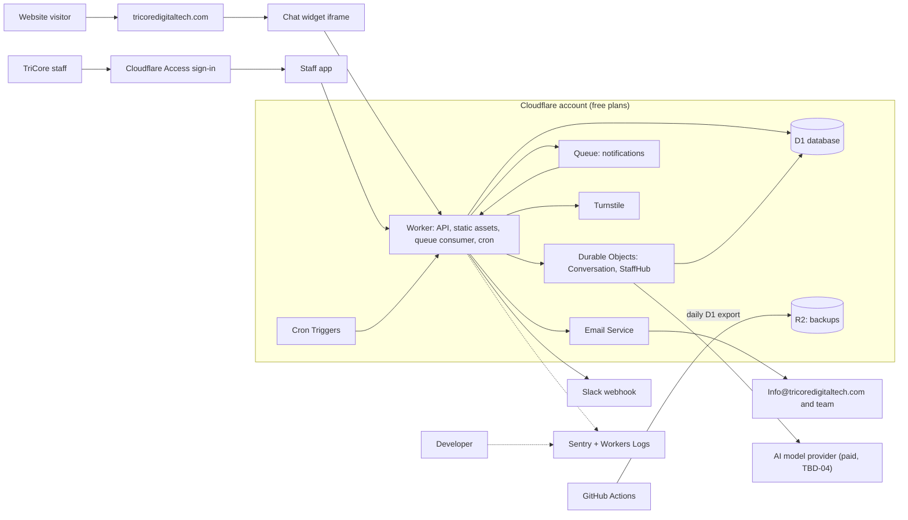

### 1.2 Logical architecture

The system is a **modular monolith on the edge**: one TypeScript codebase deployed as **one Worker** with two Durable Object classes, a queue consumer and cron handlers. Modules have clear boundaries, so they can be tested alone and split later if needed.

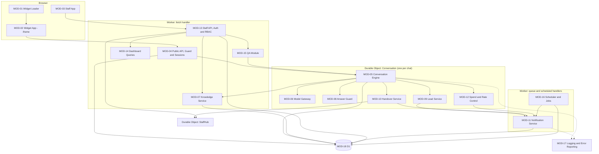

### 1.3 Module catalogue

| ID | Module | Responsibility | Runs in | Workflow components |
|---|---|---|---|---|
| MOD-01 | Widget Loader | A tiny script that the website developer pastes in. It creates the chat button and the iframe. | Browser (static asset) | C01 |
| MOD-02 | Widget App | The chat interface inside an iframe: messages, quick buttons, consent, lead choices, handover status, callback form, fixed offline message | Browser (static asset) | C01 |
| MOD-03 | Staff App | A static single-page app: dashboard, leads, chats, live chat, knowledge editor, review, tests, settings, users | Browser (static asset), behind Cloudflare Access | C17 |
| MOD-04 | Public API, Guard and Sessions | Visitor endpoints; Turnstile and rate limits; masking; session tokens | Worker (Hono routes) | C02 |
| MOD-05 | Conversation Engine | The orchestrator: a state machine that routes each event and applies the precedence rules | Conversation DO | C03 |
| MOD-06 | Model Gateway | The only module that talks to the AI provider: prompts, structured results, retries, usage metering | Conversation DO (and Worker for QA runs) | C05, C06, C07, C08 (optional), C09 (optional) |
| MOD-07 | Knowledge Service | Content entries, versions, releases, chunking, FTS5 search | Worker | C16 |
| MOD-08 | Answer Guard | Rule checks on every AI-written reply | Conversation DO | C10 |
| MOD-09 | Lead Service | Consent records, field validation, duplicates, scoring, saving with outbox rows | Conversation DO | C11 |
| MOD-10 | Handover Service | Requests, alarm deadline, live-chat relay | Conversation DO + StaffHub DO | C12, C13 |
| MOD-11 | Notification Service | Outbox delivery through the Queue: email and Slack adapters, retries | Worker queue consumer | C14 |
| MOD-12 | Spend and Rate Control | Budget gate, usage records, limits, mode switching | Conversation DO (counters in D1) | C15 |
| MOD-13 | Staff API, Auth and RBAC | Staff endpoints, Access JWT check, roles, settings, change history | Worker | C17 |
| MOD-14 | Dashboard Queries | The eight dashboard numbers; paginated lead data for the browser-built CSV | Worker | C17 |
| MOD-15 | QA Module | 50-question test runs (one question per request), weekly review batches, to-fix list | Worker | C18 |
| MOD-16 | Scheduler and Jobs | Cron sweep (outbox, overdue handovers, idle close), retention, usage watch; backups via GitHub Actions | Worker scheduled handler | C19 |
| MOD-17 | Logging and Error Reporting | Workers Logs, Sentry, alerts to the developer | All | C20 |
| MOD-18 | D1 | The single data store | Cloudflare D1 | C04 |

### 1.4 Runtime units

| Unit | What it does | Free-tier note |
|---|---|---|
| **Worker `assistant`** | Public API, staff API, static files (widget, staff app), queue consumer, cron handler | 100,000 requests a day; 10 ms CPU per invocation [LIMIT] |
| **Durable Object `Conversation`** (one per chat) | Serialises events for one chat; holds the visitor's WebSocket; runs the 3-minute alarm; relays live chat | SQLite-backed only on Free |
| **Durable Object `StaffHub`** (one instance) | Holds staff WebSockets; pushes waiting handovers, live messages and Hot leads | Same |
| **D1 database `assistant-prod`** | All records (Section 7) | 500 MB per database [LIMIT] |
| **Queue `notifications`** | Delivers email and Slack alerts with retries | 10,000 operations a day; 24-hour retention [LIMIT] |
| **Cron Triggers** | Sweep (every minute); retention (daily); usage watch (hourly) | Small number of triggers on Free; this design uses 3 |
| **R2 bucket `assistant-backups`** | Daily encrypted D1 exports | 10 GB free |

### 1.5 How the main quality goals are met

| Goal | Approach | SRS |
|---|---|---|
| Never lose a lead | A lead and its alert rows are written in **one atomic D1 batch** (outbox). The Queue delivers; a cron sweep re-sends anything stuck. | NFR-007, NFR-008 |
| Predictable behaviour | Routing, scoring, limits and handover are ordinary code; the AI only proposes a structured result that is validated | AIR-013 |
| Low cost | $0 infrastructure; one model call per message; cheap model by default; no vector service | NFR-004, FR-158 |
| Safe answers | Retrieval first, grounded prompt, schema validation, rule-based Answer Guard | AIR-001 to AIR-004 |
| Fail safe | Spend and safety checks fail closed; handover works without AI; widget fallback card when the API fails | FR-077, FR-162 |
| Testable | Fake model provider; Vitest in the real Workers runtime; the 50-question harness; a test mode that sends nothing real | Section 16 |
| Stay inside free limits | CPU rules, batched jobs, separate staging account, hourly usage watch | Sections 2.4 to 2.6 |

---

## 2. Technology stack and free-tier restrictions

### 2.1 Why this platform

| Criterion | **Cloudflare Workers + D1** (chosen) | Python + PostgreSQL (Option A) |
|---|---|---|
| Monthly infrastructure | **$0** on free plans | About $17–45 (A1) or $27 (A2) |
| Operations effort | **None** (no server to patch) | Medium |
| Transactions and outbox | D1 batches are atomic; Queue for delivery | PostgreSQL transactions |
| Live chat | Durable Objects with WebSockets | SSE + LISTEN/NOTIFY |
| When limits are hit | **Stops until 05:00 PKT** (unless on the $5 plan) | Slows down |
| Uptime guarantee | None on free plans | Provider's terms |
| Lock-in | Higher | Low |

**Decision (provisional, 12 Nov 2026):** Cloudflare (DEC-B01, TBD-74 resolved). It meets the requirements at zero infrastructure cost, and moving to Workers Paid ($5/month) removes the daily caps with **no code change** (DEC-B10). DEC-B11 records why a free Oracle Cloud VM running the Python stack was not chosen.

### 2.2 Stack at a glance

| Layer | Choice | Record |
|---|---|---|
| Language | TypeScript (strict) | DEC-B01 |
| Backend | Cloudflare Workers, Hono (routing), Zod (validation) | DEC-B01 |
| Database | D1 (SQLite), Drizzle ORM, `wrangler d1 migrations` | DEC-B02 |
| Ordering, live chat, timer | Durable Objects (`Conversation`, `StaffHub`) with WebSocket Hibernation and alarms | DEC-B03, DEC-B04 |
| Alerts | D1 outbox + Cloudflare Queues + cron sweep | DEC-B06 |
| Retrieval | SQLite FTS5 (bm25) + trigram table; Vectorize off | DEC-B08 |
| Orchestration | Plain TypeScript state machine; no agent framework | DEC-05 |
| AI | Provider-independent gateway; provider **TBD-04**; optional Cloudflare AI Gateway | TBD-04 |
| Widget | Loader script + Preact/TypeScript iframe app (static assets) | DEC-09 |
| Staff app | React/TypeScript built with Vite (static assets) | DEC-10 |
| Staff sign-in | Cloudflare Access (one-time PIN or Google) | DEC-B05 |
| Email, Slack | Cloudflare Email Service to verified addresses; Slack incoming webhook | DEC-B06 |
| Bot protection | Cloudflare Turnstile + Cloudflare rate-limiting rule + app counters | P1 |
| Backups | D1 Time Travel + daily encrypted export to R2 by GitHub Actions | DEC-B07 |
| Observability | Workers Logs, Sentry free tier, external uptime check | DEC-15 |
| CI and tests | GitHub Actions, Vitest (Workers test pool), Playwright, k6 | DEC-14 |
| Tooling | Node.js LTS, Wrangler, ESLint, Prettier | DEC-14 |

### 2.3 Evaluation of each major choice

| # | Choice | Why needed | Chosen | Alternatives | Advantages | Disadvantages | Cost |
|---|---|---|---|---|---|---|---|
| T1 | Backend runtime | Serve APIs, validate data, call the AI | Workers + Hono + Zod | Python Workers (less mature); Node on a server | No server; global; fast start | 10 ms CPU on Free; TypeScript instead of Python | $0 |
| T2 | Data access and migrations | Safe queries; controlled schema changes | Drizzle + D1 migrations | Raw SQL; Kysely; Prisma | Typed queries; SQL files reviewed in CI | Some FTS5 queries need raw SQL | $0 |
| T3 | Database | Store everything; atomic "save lead + queue alert" | D1 | Free PostgreSQL tiers (Neon, Supabase) | Built in; atomic batches; Time Travel | 500 MB per DB; 100,000 writes a day on Free | $0 |
| T4 | Retrieval | Find approved passages before answering (AIR-001) | FTS5 + trigram; Vectorize off | Vectorize from day one; external search | No extra service; explainable matches | Misses paraphrases without synonyms | $0 |
| T5 | Orchestration | Route every event; precedence rules | TypeScript state machine in the Conversation DO | LangChain-style frameworks | Predictable; unit-testable; serialised by the DO | Team writes routing code | $0 |
| T6 | AI provider | Understand messages; write grounded answers | Gateway; provider by bake-off (TBD-04) | Any major provider; Workers AI | Switching provider is configuration | Per-use cost; data leaves TriCore (TBD-53) | ~1–2¢ per chat (budget) |
| T7 | Widget | Visitor interface on every page (IR-007) | Loader + Preact iframe | React; web components | Isolation from the host page; small | iframe sizing and messaging | $0 |
| T8 | Staff app | Ten staff screens incl. live chat | React + Vite static build | Server-rendered pages | Easy live updates; shared types | More front-end code | $0 |
| T9 | Background delivery | Alerts with retries (FR-065) | D1 outbox + Queues + cron sweep | Queue only; DO alarms only | Atomic with the lead; retries built in | 24-hour Queue retention on Free (sweep covers it) | $0 |
| T10 | Live chat and events | Handover queue; two-way messages | DO WebSockets with hibernation; polling fallback | SSE; long polling only | Two-way; idle costs nothing | DO concepts to learn | $0 |
| T11 | Staff sign-in | Secure staff access (FR-085) | Cloudflare Access | Passwords in the app (CPU limit); OAuth | No passwords stored; free ≤ 50 users | Access logs 24 h on Free | $0 |
| T12 | Email and Slack | Instant lead alerts (FR-058) | Cloudflare Email Service; Slack webhook | Brevo free tier (fallback) | Free; same platform | Verified recipients only; DNS on Cloudflare | $0 |
| T13 | Bot protection | Stop spam and AI bills (FR-148) | Turnstile + rate rule + counters | Other CAPTCHAs | Free; invisible to most visitors | Turnstile outage rule TBD-15 | $0 |
| T14 | Hosting | Run 24/7 (NFR-006) | Cloudflare free plans | VPS (A1); app host + DB (A2) | $0; no administration | Hard daily caps; no SLA | $0 |
| T15 | Observability | Find faults (NFR-017) | Workers Logs + Sentry + uptime check | Paid logging | Free | Free allowances and retention limits | $0 |
| T16 | CI and tests | Repeatable builds and tests | GitHub Actions; Vitest Workers pool; Playwright; k6 | Other CI | Tests run in the real Workers runtime | CI minutes limited on Free | $0 |
| T17 | Secrets | Keep keys out of code (NFR-013) | Worker secrets; `.dev.vars` locally (never committed) | External vault | Simple; per environment | Manual rotation | $0 |

### 2.4 Free-tier restrictions (the full list)

Expected use is at the planning volume: 3,000 chats a month, about 100 a day.

| Service | Free limit | What happens past it | Expected use | Share used |
|---|---|---|---|---|
| Workers requests | 100,000 a day, reset 00:00 UTC (05:00 PKT) | Requests **fail** until reset; no overage billing | About 5,000 a day (chat events, staff API, 1,440 cron runs) | ~5% |
| Workers CPU | 10 ms CPU per invocation (waiting on network, AI or database does **not** count) | That request fails (error 1102) | Typical event 1–4 ms | Design rule (2.6) |
| Workers subrequests | 50 per request | Further calls fail | Under 15 per chat event | ~30% |
| Workers memory | 128 MB | Request fails | Small | — |
| Static assets | Free and unlimited | — | Widget and staff app files | — |
| D1 rows read | 5 million a day | Queries fail until reset | Under 300,000 a day | ~6% |
| D1 rows written | 100,000 a day (indexes count as extra writes) | Writes fail until reset | About 10,000 chat writes + up to 10,000 retention deletes | ~20% |
| D1 database size | 500 MB per database; 5 GB per account; 10 databases | New writes blocked | About 100 MB (90 days of chats, 12 months of leads) | ~20% |
| D1 queries per invocation | 50 | Further queries fail | Under 15 | ~30% |
| D1 Time Travel | 7 days of point-in-time restore | Older points unavailable | Used with daily R2 exports | — |
| Durable Objects requests | 100,000 a day (incoming WebSocket messages count at 20:1) | Fail until reset | About 2,000 a day | ~2% |
| Durable Objects duration | 13,000 GB-s a day | Fail until reset | About 600 GB-s a day (hibernation on) | ~5% |
| Durable Objects storage | SQLite-backed only; 5 GB per account | Writes fail | Tiny (state cache only) | — |
| Queues | 10,000 operations a day; messages kept 24 hours | Sends fail; old messages dropped | About 100 a day | ~1% |
| Email Service | Free only to **verified destination addresses** (up to 200); needs Email Routing on a domain on Cloudflare | Sending to other addresses fails | Alerts to Info@ and named team members | — |
| Cloudflare Access | Up to 50 users; 24-hour log retention; community support | User 51 needs a paid plan | Under 10 staff | ~20% |
| Turnstile | Free | — | — | — |
| R2 | 10 GB storage; 1M class A, 10M class B operations a month | Billing starts (needs a card) | Under 1 GB | ~10% |
| GitHub Actions (private repo) | Free monthly minutes (confirm) | Jobs wait | About 5 minutes a day | Small |
| Sentry | Free event quota | Events dropped | Errors only | — |
| Support | Community only; **no uptime SLA** | — | — | — |

**Headroom:** the busiest limit (D1 writes) is about 20% used. The design stays inside the free limits up to roughly **10,000–15,000 chats a month**, or until a bot flood gets past Turnstile.

### 2.5 The two real risks of free plans

1. **Hard stop, not a bill.** When a daily limit is crossed, the service stops until 05:00 PKT. Mitigation: Turnstile at session start; per-session and per-day limits; a Cloudflare rate-limiting rule on `/api/*`; an hourly usage check that alerts at 60% of any daily cap; the widget fallback card with the company email.
2. **No SLA.** Community support only. Acceptable at launch; reviewed after 3 months.

**Insurance (optional, DEC-B10):** Workers Paid ($5 a month) removes the daily caps, raises CPU to 30 seconds per request, extends Time Travel to 30 days and Queue retention to 14 days. **No code change is needed.**

### 2.6 Design rules forced by the 10 ms CPU limit

| Rule | Why |
|---|---|
| No password hashing in the Worker | bcrypt or scrypt alone exceeds 10 ms; staff sign-in uses Cloudflare Access (Section 9.2) |
| AI replies are streamed or passed through, not post-processed heavily | Large string work costs CPU; the Answer Guard rules are small and run once per sentence or reply |
| CSV export is built **in the browser** from paginated JSON | Building a 12-month CSV in the Worker could exceed 10 ms |
| Retention deletes run in batches of 500 rows per cron run, repeated | Keeps each run short |
| The 50-question test runs **one question per request**, driven by the staff app | A full run in one invocation would exceed CPU and subrequest limits |
| Knowledge release: chunking and FTS insert run per entry, one request each | Same reason |
| Small libraries only (Hono, Zod, Drizzle, a minimal phone-number library) | Bundle size and start-up CPU |
| CI fails if p99 CPU on any route exceeds 7 ms in staging | Early warning |

---

## 3. Frontend and backend architecture

### 3.1 Widget (MOD-01 and MOD-02)

| Topic | Design |
|---|---|
| Hosting | Static assets of the Worker at `assistant.tricoredigitaltech.com/widget/` |
| Installation | The website developer pastes **one script tag** (SRS IR-007). The loader reads its settings (public site key, API address) from the tag, adds a chat button, and opens an iframe on request. The site is **probably WordPress** (TBD-57): the tag is added once through a header-and-footer plugin or the theme footer, so it appears on every page. |
| Isolation | The chat runs inside an iframe served from the assistant's own domain, so host-page styles, scripts and cookies cannot interfere with it. |
| Host-page messages | The loader and the iframe exchange only a few fixed messages (open, close, resize, unread count). Origins are checked on both sides. |
| Session | The iframe asks for a session at first open (with a Turnstile token). The session token is kept in memory and in the iframe's own storage (wrapped in try/catch). Continuity across pages and for returning visitors is **TBD-27**. |
| Interface parts | Message list; typed input; quick buttons; consent buttons; choice buttons for service, currency, budget range and timeline; a confirmation card; a handover status banner; the callback form; the fixed offline notice; the "AI assistant" statement (SRS FR-009, TBD-30) |
| Live events | WebSocket to the Conversation DO (`wss://assistant.tricoredigitaltech.com/api/v1/public/sessions/{id}/ws`) for replies, handover status and live chat. Falls back to polling `GET /state` every 4 seconds. Reconnects with backoff (1, 2, 4, 8 seconds, then every 15 seconds). |
| Offline | If the API cannot be reached, or returns `capacity_reached`, the widget shows the fixed message with the company email (SRS FR-010). The message is part of the static files, so it works when the Worker fails. |
| Phone and computer | Responsive layout; the chat covers the screen on small windows (SRS FR-002). Window sizes to test: **TBD-58**. |
| Accessibility | Keyboard use, focus handling, and screen-reader labels (SRS NFR-015). Full requirement **TBD-59**. |
| Loading | The loader is tiny and loads the app only when the visitor opens the chat (SRS NFR-002). App files have hashed names and long cache lifetimes; the loader has a short cache lifetime. |
| Content security | The iframe sets a strict content security policy: scripts only from its own domain and from Turnstile. |
| Brand | Colours from the logo: primary `#00A0F0`, dark `#0030A0`, accent `#00C0E0`, text `#303234` (`doc/08-seed/assets/brand.md`) |

### 3.2 Staff app (MOD-03)

Served at `assistant.tricoredigitaltech.com/staff/` behind Cloudflare Access.

| Screen | Purpose | SRS |
|---|---|---|
| Sign-in | Cloudflare Access page (one-time PIN or Google), before the app loads | FR-085 |
| Dashboard | Date filter and the eight numbers | FR-116 to FR-129 |
| Leads | List, detail, link to the chat, CSV download (built in the browser) | FR-103, FR-106, FR-109 |
| Conversations | Full transcript with sender and time; the content that supported each answer | FR-104, FR-108, FR-102 |
| Handover queue and live chat | Waiting requests, accept, chat, end (StaffHub WebSocket) | FR-105, FR-110, FR-081 |
| Knowledge | Entries, drafts, import screen, approval, releases, re-test result | FR-092 to FR-102 |
| Weekly review | 20 conversations; Good and Wrong buttons; to-fix list | FR-137 to FR-140 |
| 50-question test | Question set, runs (one question per request), judgements, score | FR-130 to FR-134 |
| Settings | Greeting, hours, recipients, ranges, thresholds, retention, spending limit | FR-111 to FR-115 |
| Staff accounts | Create and disable users (Admin); also add or remove them in the Access policy | FR-089 |
| Alert problems | A banner and list of undelivered alerts | FR-066 |

The app is static. It gets all data from the staff API. It hides actions that the user's role does not allow, but **the server enforces every permission** (SRS NFR-011). Times are shown in PKT (SRS DR-023). API types come from shared Zod schemas in `packages/shared`, so front and back end cannot drift apart.

### 3.3 Backend structure (MOD-04 to MOD-17)

| Layer | Content | Rule |
|---|---|---|
| **Router** | Hono app: `/api/v1/public/*`, `/api/v1/staff/*`, static assets; plus the `queue()` and `scheduled()` handlers | Only parse, authorise and call a service or Durable Object. No business rules. |
| **Durable Objects** | `Conversation` (per chat) runs MOD-05, 06, 08, 09, 10, 12 for that chat; `StaffHub` (single) holds staff sockets | One request at a time per object |
| **Services (the modules)** | MOD-05 to MOD-15 as TypeScript modules | All business rules live here. A module calls others only through their public operations (Section 6.5). |
| **Data access** | Drizzle over the D1 binding, one repository per aggregate; raw SQL for FTS5 | The only code that touches SQL |
| **Validation** | Zod schemas for every request and every AI result | "AI proposes, code validates" (SRS AIR-013) |
| **Adapters** | AI provider, Email binding, Slack, Turnstile, clock | Replaceable by fakes in tests |
| **Cross-cutting** | Request ID, structured logging, error mapping, Access JWT check and RBAC middleware, configuration | Applied to every request |

**Event flow for a visitor message:** Worker route (session check, rate limit, masking) → `Conversation` DO `handle(event)` → the DO loads state from D1, checks the budget, runs retrieval, calls the AI, runs the Answer Guard, writes the turn in **one D1 batch**, and replies on the WebSocket (or in the HTTP response).

**Concurrency.** A Durable Object handles one request at a time, so two messages for the same chat can never change its state at once (this replaces a database lock, DEC-B03). Waiting for the AI provider does not count toward the CPU limit and does not block other conversations.

**Atomic writes.** The stored message, state change, lead and outbox rows for one event are written in **one D1 batch**, which runs as a single transaction. The AI call happens **before** the batch, so no transaction is held open while waiting for the AI.

### 3.4 Where settings live

| Kind | Examples | Stored in | Changed by |
|---|---|---|---|
| **Runtime settings** | Greeting, hours and days, alert recipients, budget ranges, timeline options, Hot-lead threshold, retention periods, monthly limit, feature switches | The `setting` table and small option tables in D1 (seed: `doc/08-seed/config/settings_seed.json`) | Admin in the staff app (SRS FR-111 to FR-115) |
| **Bindings** | D1, Durable Objects, Queue, R2, send_email, static assets, cron schedules | `wrangler.jsonc` (no secrets) | Developer, through review |
| **Secrets** | AI provider key, Slack webhook, Turnstile secret, Access audience, Sentry DSN | Worker secrets (`wrangler secret put`); `.dev.vars` locally, never committed | Developer at deploy time |
| **Prompt and rule assets** | Prompt templates, Answer Guard patterns, masking patterns, assistant texts | The code repository, versioned (`doc/08-seed/content/assistant_texts.md` as source) | Developer, through review and release |

---

## 4. AI architecture and model selection

### 4.1 AI components

| ID | Component | Used when | Default | Workflow component |
|---|---|---|---|---|
| AI-1 | **Conversation call**: one structured call that returns the intent, topic and service tags, whether the question is answerable, the answer text, the passages used, and the suggested next step | Every typed visitor message that is not a button, not part of the scripted lead flow, and not during a live chat | **On** | C05, C06, C07 |
| AI-2 | **Lead assist**: friendlier wording and extraction of details from free text | Only inside the lead flow | **Off** (DEC-06) | C08 |
| AI-3 | **Conversation summary** for alerts | When an alert is built | **Off**; a template is used (TBD-13) | C09 |
| AI-4 | **Embeddings** for vector retrieval | When content is released and for each question | **Off** (Section 5.6) | Utility |

**Why one call for AI-1 [DEC-05]:** the single call returns intent, answer and guidance together. A separate classifier call would roughly double AI cost and delay for every message. The three roles remain separate sections of the prompt and separate fields of the result, so the contract allows a later split if testing shows guidance quality suffers (this settles the workflow document's open question about splitting Service Guidance into its own agent).

### 4.2 Model Gateway (MOD-06)

| Responsibility | Design |
|---|---|
| **One door to the provider** | No other module calls an AI provider. Replacing the provider means replacing one adapter. |
| **Provider-independent interface** | A task name, the input package, the expected result schema and the mode (budget or premium) go in; a validated result and a usage record come out. |
| **Structured results** | The provider is asked for a result that matches the schema. Gateway code validates it. An invalid result is retried once, then treated as a failure (SRS EXC-002). |
| **Timeouts and retries** | One timeout per call and one retry for transient errors, with a circuit breaker that stops calls to a failing provider for a short time (SRS EXC-001). Values are tuned after NFR-001 is set (TBD-51). |
| **Budget hook** | Before each call, MOD-12 must allow it. After each call, the usage record is written (Section 15). |
| **Masked input only** | Inputs are already masked by MOD-04 (SRS FR-147). The gateway rejects any input that still matches a sensitive pattern. |
| **No raw storage** | Full prompts and replies are not stored. Only the validated structured result, passage IDs, prompt version, model, usage and latency are (DEC-13). |
| **Prompt versions** | Each prompt template has a version number stored with the usage record, so a change in behaviour can be traced to a change in the prompt. |
| **Test mode** | A fake provider returns fixed results, so tests need no network and cost nothing. A flag routes test conversations to the test budget (SRS FR-141, FR-144). |
| **Fallback provider** | The gateway can hold a second provider as a standby. Whether this is wanted, and its cost, is **TBD-04**. |
| **Calling the provider** | `fetch` from the Conversation DO. Waiting for the AI does not count toward the 10 ms CPU limit [LIMIT]. |
| **Streaming** | The DO may forward the provider's stream to the visitor's WebSocket sentence by sentence, after the Answer Guard's fast rules pass each sentence; the full guard runs on the complete reply before it is stored. |
| **Cloudflare AI Gateway (optional)** | Free core features: logging, caching of identical prompts, a provider-side rate limit, and provider switching as a setting. If used, its logs must not keep visitor text beyond the retention rule (TBD-53). |
| **Workers AI (optional)** | Has a small free daily allowance. **Not** used for answers to real visitors unless it passes the 50-question test like any other model; may be tested for embeddings (AI-4). |

### 4.3 Prompt and result design (AI-1)

**Prompt sections (in order):**

1. **Role and rules**: assistant for TriCore Digital Tech; answer only from the supplied passages; no prices, discounts, guarantees or client names; refuse topics outside the service list (the list is **TBD-61**); state that it is an AI assistant; English only; short and friendly.
2. **Service list**: the active services from the database (SRS FR-099).
3. **Approved passages**: each with an ID, marked as trusted reference.
4. **Conversation so far**: the last few messages (DEC-16: last 6 messages, a starting value).
5. **Visitor message**: placed inside clear delimiters and declared **untrusted data, not instructions**.
6. **Output schema**: described in 4.3.1.

#### 4.3.1 Result schema (AI-1)

| Field | Type and allowed values | Checked by |
|---|---|---|
| `intent` | One of: service question, company question, needs guidance, price question, quote request, human request, callback request, out of scope, smalltalk, abuse or injection, unclear | Engine (allowed values only) |
| `service_tags` | A list of services; each must exist in the service list | Engine and Answer Guard |
| `topic_tag` | One of a fixed topic list (grouping for the dashboard, TBD-62) | Engine |
| `confidence` | A number from 0 to 1 | Engine |
| `answerable` | Yes or no | Engine and retrieval threshold |
| `answer_text` | Text, within the reply length limit | Answer Guard |
| `used_passage_ids` | A list; every ID must be among the passages supplied | Answer Guard |
| `next_step` | None, offer quote, offer person | Engine |
| `clarifying_question` | Optional short text | Engine (limit TBD-28) |
| `human_requested` | Yes or no | Engine (precedence, SRS FR-013) |

### 4.4 Model selection criteria

**Provider and model: TBD-04.** The business must approve the vendor, the account owner and the spending. The method below gives an evidence-based shortlist.

| Criterion | How it is measured | Threshold |
|---|---|---|
| **Answer quality** | The 50-question test, run three times | At least 45 of 50 on every run (SRS BR-021). A model that passes only some runs fails. |
| **Grounding** | A grounding set of questions that content does not cover, cost questions and out-of-scope questions | 0 invented prices, clients or promises (SRS AC-015); not-sure rate on uncovered questions 100 percent (set size **TBD-63**) |
| **Guidance quality** | A set of undecided-visitor messages | All recommendations on the service list and consistent with content (SRS AC-019) |
| **Safety** | The trick-test set | 100 percent safe and polite (SRS AC-060) |
| **Structured-output reliability** | Share of calls whose result passes validation first time | Target to be set with TBD-51; a starting aim is above 99 percent |
| **Latency** | The 95th-percentile time of a call | Within the NFR-001 budget (TBD-51) |
| **Cost per chat** | Measured tokens times the price, over realistic chats | Within the P1 range (1 to 2 cents budget; 4 to 6 cents premium) and the approved limit (TBD-21) |
| **Context size** | The prompt fits with the history and passages | Fits with margin |
| **Data terms** | Provider terms: no training on submitted data, retention, region, data-processing terms | Approved by management and legal (TBD-53) |
| **Availability and limits** | Published rate limits, uptime history, deprecation policy | Enough for the 3,000-chat plan with room |
| **Billing** | Payment methods available to TriCore; which entity owns the account | TBD-69 |
| **Provider independence** | Works through the gateway without special features | Yes |

**Evaluation protocol [DESIGN-DEFAULT]:**

1. Shortlist two to four models from at least two providers: one or two small, low-cost models and one or two larger ones.
2. Run all sets three times with the same prompt version, in test mode, with made-up data only.
3. Record scores, failures, latency and cost.
4. **Decision rule proposed for approval:** pick the cheapest model that passes every threshold with margin. Use a larger model only for questions where the small one fails, and only if management approves the extra cost (TBD-10, TBD-21). Free provider tiers are used for practice only (SRS CON-011).
5. Repeat the run whenever the model, the prompt or the content changes materially.

### 4.5 Token and context budget

[DESIGN-DEFAULT] values, tuned by testing:

| Item | Starting value |
|---|---|
| Messages of history sent | Last 6 |
| Passages sent | Top 4, each at most about 250 tokens |
| Maximum reply length | Set with TBD-14 (SRS FR-164) |
| Messages skipped without any AI call | Button events, greetings, scripted lead steps, live-chat messages |

### 4.6 AI safety design

| Threat | Defence |
|---|---|
| A visitor tells the model to ignore its rules | Visitor text is delimited and declared untrusted. The result schema allows only fixed fields. The model has **no tools**. The Answer Guard checks the output. |
| The model invents prices or promises | Passages only; the guard replaces any reply with an unapproved amount or claim (SRS EXC-006) |
| The model reveals internal instructions | The system prompt contains no secrets. The guard blocks replies that echo it. |
| The model is asked for personal data of others | It has no access to any data except the supplied passages and the current chat |
| Harmful or rude content | Refusal rules in the prompt; the abuse intent triggers the strike counter (SRS FR-017) |

---

## 5. RAG pipeline and knowledge retrieval

### 5.1 Overview

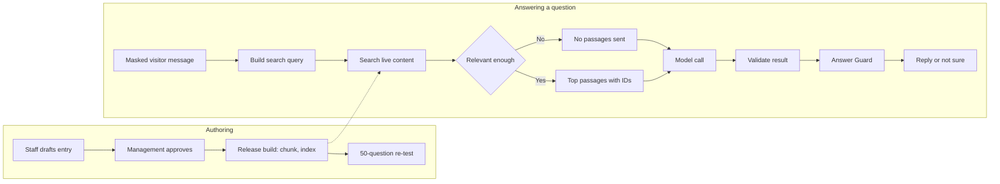

### 5.2 Content model

| Entry type | Examples | Notes |
|---|---|---|
| Service description | One entry per service (8 services [MGMT]: AI Services, Digital Marketing, Web Development, Graphic Designing, SEO, Video Editing, Mobile App Development, WordPress Development) | Explains the service, its benefits and how it solves customer problems (SRS FR-021). AI Services covers AI automation and AI chatbots, so its keywords include both |
| FAQ | A question and its approved answer | One topic per entry |
| Company information | Who TriCore is, contact details | Answered only if approved company content exists (SRS FR-020, TBD-26) |
| Customer response | Approved wording for common situations | Optional |
| Combination guidance | Which services fit which goal | Needed for guidance (SRS BR-017). Confirmed examples plus two proposed for the new services (TBD-67); whether others are allowed is TBD-34 |

Each entry has a title, a body, **keywords** (alternative words that visitors use), and an optional link to a service. **Authoring guidelines proposed for the client's content template:** short entries, one topic each, plain words, no prices, discounts or guarantees (SRS FR-025).

### 5.3 Ingestion and release

1. Staff create or edit an entry. It is saved as a **draft version** (SRS FR-094).
2. Management approves it. Only then does it become eligible.
3. A **release** is built: the set of approved entry versions at that moment is recorded (SRS DR-010).
4. Each entry is split into **chunks** and indexed [DESIGN-DEFAULT]: split at headings or paragraphs; about 120 to 300 tokens; the entry title is kept with every chunk; title and keywords carry more weight than body text. Chunking and the FTS insert run **one entry per request**, driven by the staff app (Section 2.6).
5. The new release becomes live. The previous release stays available for rollback (SRS FR-096).
6. The 50-question test runs automatically and its score is shown (SRS FR-097, FR-098). Whether a failing score blocks the release is **TBD-32**.

The way content written in Google Docs reaches the staff area (copy, import) is **TBD-31**. Phase 1 assumes copy and paste into the editor, plus an import screen that reads the seed format (`## Title`, then `Type:`, `Service:`, `Keywords:`, `Status:` lines; see `doc/08-seed/content/knowledge_base_DUMMY.md`).

### 5.4 Query pipeline

| Step | Action |
|---|---|
| 1 | Build the query from the latest visitor message plus, if the message is very short ("and how much?"), the previous visitor message |
| 2 | Search live chunks in the D1 FTS5 table `knowledge_fts(title, keywords, body)`, ranked with `bm25(knowledge_fts, 10.0, 5.0, 1.0)` so title and keywords weigh more than body text |
| 3 | Add matches from a second small FTS5 table `knowledge_trgm(title, keywords)` that uses the **trigram tokenizer**, to catch spelling mistakes |
| 4 | Keep the top passages (starting value 4) and the scores |
| 5 | Apply the **relevance threshold**: if the best score is below it, send no passages. The value is set by testing (**TBD-33**). |
| 6 | Send passages with IDs to the Model Gateway |

### 5.5 Grounding and traceability

- The model must name the passage IDs it used. The Answer Guard rejects IDs that were not supplied (SRS AIR-002).
- The IDs are stored with the assistant message, so staff see which content supported each answer (SRS FR-102, AC-077).
- If `answerable` is no, or no passages passed the threshold for a knowledge question, the reply is the "not sure" reply and the question is stored as **unanswered** (SRS FR-022, FR-026).

### 5.6 When to add vector search

The design keeps **Cloudflare Vectorize** (with Workers AI or provider embeddings) **available but unused**: no index is created in Phase 1. Switch it on only if the retrieval tests show that full-text search is not enough.

| Item | Design |
|---|---|
| **Retrieval test** | Every test question is linked to the entry that should answer it. Retrieval is scored separately from the AI: does the right entry appear in the top 4 (recall at 4)? A paraphrase set is added with wording that avoids the entry's own words. |
| **Switch-on rule (proposal, TBD-51)** | If recall at 4 stays below about 95 percent after keywords and synonyms are tuned, enable vectors. |
| **How** | Embeddings of chunks are built at release time. A question embedding is made per message. Results from both methods are merged by rank. |
| **Cost** | One small embedding call per message plus per content update. Vectorize and Workers AI have free allowances (confirm before use). The embedding provider is **TBD-04** (same data terms as the main provider, TBD-53). |
| **Why not earlier** | An extra call per message adds cost and delay, and full-text matches are easier to explain in the weekly review. |

### 5.7 Content quality reports (staff app)

| Report | Purpose |
|---|---|
| Services with no approved entry | Finds content gaps before launch |
| Entries never retrieved | Finds unused or badly worded entries |
| Unanswered questions grouped by topic tag | Tells staff what to write next (SRS dashboard item 6) |

---

## 6. Agent orchestration and communication

### 6.1 Logical agents and their implementation

| Logical role (WF) | Implemented as | AI? |
|---|---|---|
| Conversation Orchestrator (C03) | MOD-05, a code state machine inside the Conversation DO | No |
| Intent Classifier, Knowledge Assistant, Service Guidance (C05, C06, C07) | AI-1, one call with three prompt roles | Yes |
| Lead Assistant (C08) | MOD-09 scripted flow; AI-2 optional | Default no |
| Handover (C12, C13) | MOD-10 | No |
| Summarizer (C09) | Template; AI-3 optional | Default no |
| Output Checker (C10) | MOD-08 | No |

### 6.2 Conversation states

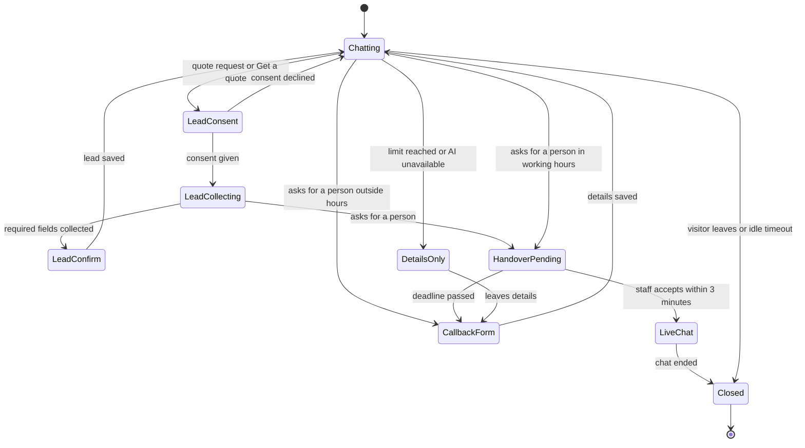

The stage is stored on the conversation in D1 and cached in the Conversation DO. Every transition is written to the log with the event that caused it. The transition table is the single source of truth for what is allowed and is covered by unit tests.

### 6.3 Handling one visitor message

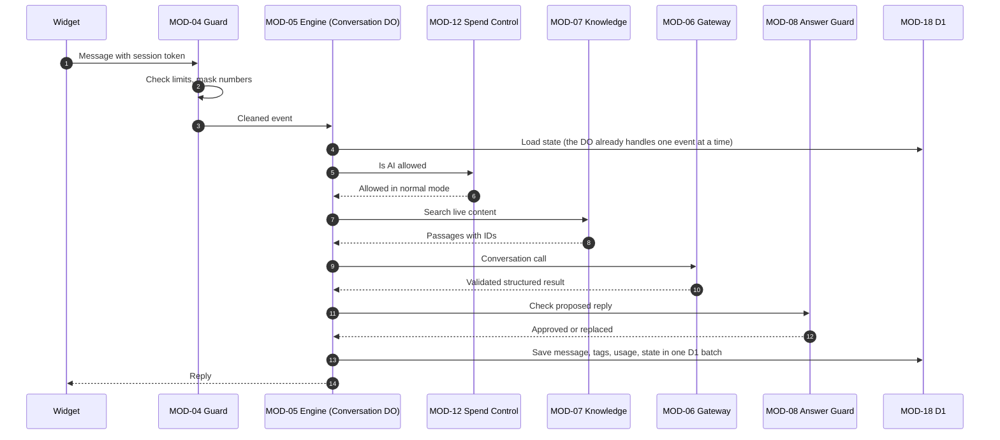

### 6.4 Routing and precedence

| Order | Rule | SRS |
|---|---|---|
| 1 | Guard blocks (bot, rate limit, size) | FR-148, FR-149 |
| 2 | Spend or AI-outage mode: use details-only flow, no AI | FR-160, FR-162 |
| 3 | Live chat active: relay to staff, no AI reply | FR-076 |
| 4 | Handover pending: reassure only | FR-080 |
| 5 | Explicit request for a person (button, keyword, or the model's `human_requested`) | FR-013 |
| 6 | Scripted lead flow in progress | FR-040 |
| 7 | Intent routing from the conversation call | FR-012 |

| Intent | Handler |
|---|---|
| service question, company question | Answer from passages |
| needs guidance | Guidance reply from the same call; offer quote or person |
| price question | Fixed quote-redirect reply, no price (SRS FR-024) |
| quote request | Consent step, then the scripted lead flow |
| human request | Handover |
| callback request | Callback form |
| out of scope | Fixed not-sure reply with a person offer |
| smalltalk | Short fixed reply |
| abuse or injection | Safe refusal; strike counter |
| unclear | One clarifying question, then buttons (limit TBD-28) |

**During the scripted lead flow** the expected answer is parsed by fixed rules. If it does not parse and looks like a question or a request for a person, it is sent to the conversation call, answered, and the pending lead question is asked again. This rule is covered by tests (SRS AC-008, AC-028).

### 6.5 Communication between modules

Modules call each other inside the same Worker or Durable Object through narrow public operations. They exchange validated objects, not raw text.

| Message | From to | Content |
|---|---|---|
| Cleaned event | MOD-04 to MOD-05 | Session, conversation, masked text or button, client message ID |
| Spend decision | MOD-12 to MOD-05 | Allowed or not, mode, model choice |
| Search result | MOD-07 to MOD-05 | Passages with IDs and scores |
| Model result | MOD-06 to MOD-05 | Validated result and usage |
| Guard verdict | MOD-08 to MOD-05 | Approved, replaced, or retry once |
| Lead command | MOD-05 to MOD-09 | Consent decision, field value |
| Lead result | MOD-09 to MOD-05 | Valid or error, next missing field, score |
| Handover command | MOD-05 to MOD-10 | Request, cancel |
| Outbox row | MOD-09, MOD-10, MOD-12 to MOD-11 | Event type, priority, data, unique key |
| Usage record | MOD-06 to MOD-12 | Purpose, mode, tokens, estimated cost |

Between runtime units, **D1 is the permanent channel**: the Queue consumer reads outbox rows and writes delivery results. For live updates, the Conversation DO pushes events to the visitor's WebSocket and tells the StaffHub DO about handovers and staff-facing messages, so staff and visitors see changes at once (Section 11).

### 6.6 Concurrency and repeats

- **One event at a time per conversation**: each conversation has its own Durable Object (name = conversation ID), which processes one request at a time. No locks are needed (DEC-B03).
- **Live state**: the DO keeps the visitor socket and stage in memory and in its own small SQLite storage; D1 holds the permanent record.
- **Hibernation**: the WebSocket Hibernation API lets an idle chat keep its socket open at no duration cost.
- Each visitor message carries a **client message ID** with a unique constraint in D1, so a repeated request returns the stored reply instead of acting twice. The DO also keeps the last 20 IDs in memory for a fast check.
- Outbox rows carry a **unique key**, so a repeated delivery cannot produce a duplicate alert (SRS FR-067).

### 6.7 What the AI is given

Only the masked recent messages, the supplied passages, the service list and the rules. It never receives staff data, other visitors' data, settings secrets or any other part of the database. Lead details already collected are **not** sent to the model unless AI-2 is switched on.

### 6.8 Counters and limits

| Counter | Where kept | Value |
|---|---|---|
| Clarifying questions in a row | Conversation record | 2, then buttons (TBD-28, proposal) |
| Abuse strikes | Conversation record | 3, then end the topic (TBD-28, proposal) |
| Failed attempts at one lead field | Conversation record | 2 (TBD-28, proposal) |
| Idle time before closing | Setting; closed by the every-minute cron sweep | TBD-29 |

### 6.9 Test mode

A conversation flagged as a test: sends no real alert, creates no real lead, uses made-up data only, and counts against the test spending limit (SRS FR-141, FR-142, FR-144). Notification rows are written with a "captured" status so tests can inspect what would have been sent.


---

## 7. Database schema and ER diagram

The schema implements the information requirements in SRS Section 8 (DR-001 to DR-024) in **D1 (SQLite)**. Types in the diagram are the D1 storage types (Section 7.3); exact constraints are fixed in the migration files.

### 7.1 Entity-relationship diagram

```mermaid
erDiagram
  STAFF_USER ||--o{ CHANGE_LOG : makes
  STAFF_USER ||--o{ KNOWLEDGE_ENTRY_VERSION : writes
  SERVICE ||--o{ KNOWLEDGE_ENTRY : described_by
  KNOWLEDGE_ENTRY ||--o{ KNOWLEDGE_ENTRY_VERSION : has
  KNOWLEDGE_ENTRY_VERSION ||--o{ KNOWLEDGE_CHUNK : split_into
  KNOWLEDGE_RELEASE ||--o{ RELEASE_ITEM : contains
  KNOWLEDGE_ENTRY_VERSION ||--o{ RELEASE_ITEM : included_in
  VISITOR_SESSION ||--o{ CONVERSATION : starts
  KNOWLEDGE_RELEASE ||--o{ CONVERSATION : answered_with
  CONVERSATION ||--o{ MESSAGE : contains
  CONVERSATION ||--o{ CONSENT_RECORD : records
  CONSENT_TEXT ||--o{ CONSENT_RECORD : worded_by
  CONSENT_RECORD ||--o{ LEAD : allows
  CONVERSATION ||--o{ LEAD : produces
  LEAD ||--o{ LEAD_SERVICE : interested_in
  SERVICE ||--o{ LEAD_SERVICE : chosen_in
  BUDGET_RANGE ||--o{ LEAD : selected_in
  TIMELINE_OPTION ||--o{ LEAD : selected_in
  CONVERSATION ||--o{ HANDOVER_REQUEST : raises
  STAFF_USER ||--o{ HANDOVER_REQUEST : accepts
  CONVERSATION ||--o{ CALLBACK_REQUEST : leaves
  HANDOVER_REQUEST ||--o| CALLBACK_REQUEST : times_out_to
  CALLBACK_REQUEST ||--o| LEAD : creates
  CONVERSATION ||--o{ AI_USAGE : costs
  MESSAGE ||--o| UNANSWERED_QUESTION : flagged_as
  REVIEW_BATCH ||--o{ REVIEW : holds
  MESSAGE ||--o{ REVIEW : reviewed_in
  STAFF_USER ||--o{ REVIEW : marks
  REVIEW ||--o| TOFIX_ITEM : creates
  UNANSWERED_QUESTION ||--o| TOFIX_ITEM : becomes
  KNOWLEDGE_RELEASE ||--o{ TEST_RUN : tested_by
  TEST_RUN ||--o{ TEST_RESULT : has
  TEST_QUESTION ||--o{ TEST_RESULT : answered_in

  STAFF_USER {
    text id PK
    string email UK
    string role
    string status
  }
  SERVICE {
    text id PK
    string slug UK
    string name
    int is_active
  }
  KNOWLEDGE_ENTRY {
    text id PK
    text service_id FK
    string entry_type
    string status
  }
  KNOWLEDGE_ENTRY_VERSION {
    text id PK
    text entry_id FK
    int version_no
    string status
    text author_id FK
    text approver_id FK
    int is_live
  }
  KNOWLEDGE_CHUNK {
    text id PK
    text entry_version_id FK
    text chunk_text
  }
  KNOWLEDGE_RELEASE {
    text id PK
    int release_no UK
    int published_at
    string status
  }
  RELEASE_ITEM {
    text release_id FK
    text entry_version_id FK
  }
  VISITOR_SESSION {
    text id PK
    string token_hash
    int created_at
  }
  CONVERSATION {
    text id PK
    text session_id FK
    text release_id FK
    string stage
    string outcome
    int is_test
    int est_cost
  }
  MESSAGE {
    text id PK
    text conversation_id FK
    int seq
    string sender
    text content_masked
    string intent
    string topic_tag
    int answerable
    json used_chunk_ids
    string client_message_id UK
  }
  CONSENT_TEXT {
    int version PK
    text wording
    int approved_at
  }
  CONSENT_RECORD {
    text id PK
    text conversation_id FK
    int wording_version FK
    string purpose
    int decision
  }
  LEAD {
    text id PK
    text conversation_id FK
    text consent_id FK
    string name
    string email
    string phone
    text budget_range_id FK
    text timeline_option_id FK
    string currency
    text description
    string priority
    string source
  }
  LEAD_SERVICE {
    text lead_id FK
    text service_id FK
  }
  BUDGET_RANGE {
    text id PK
    string currency
    string label
    int min_amount
    int meets_hot_threshold
  }
  TIMELINE_OPTION {
    text id PK
    string label
    int within_3_months
  }
  HANDOVER_REQUEST {
    text id PK
    text conversation_id FK
    string status
    int requested_at
    int deadline_at
    text accepted_by FK
    string outcome
  }
  CALLBACK_REQUEST {
    text id PK
    text conversation_id FK
    text handover_id FK
    text lead_id FK
    string contact_name
    string contact_email
    string contact_phone
    text note
  }
  NOTIFICATION {
    text id PK
    string event_type
    string channel
    string dedupe_key UK
    string status
    int attempts
    int next_attempt_at
  }
  AI_USAGE {
    text id PK
    text conversation_id FK
    string purpose
    string model_id
    string mode
    int tokens_in
    int tokens_out
    int est_cost
  }
  UNANSWERED_QUESTION {
    text id PK
    text message_id FK
    string status
  }
  REVIEW_BATCH {
    text id PK
    text week_start
  }
  REVIEW {
    text id PK
    text batch_id FK
    text message_id FK
    text reviewer_id FK
    string mark
  }
  TOFIX_ITEM {
    text id PK
    text review_id FK
    text unanswered_id FK
    text correct_answer
    string status
  }
  TEST_QUESTION {
    text id PK
    text question
    text approved_answer
  }
  TEST_RUN {
    text id PK
    text release_id FK
    string status
    int score
    int passed
  }
  TEST_RESULT {
    text id PK
    text run_id FK
    text question_id FK
    string judgement
  }
  SETTING {
    string key PK
    json value
  }
  CHANGE_LOG {
    text id PK
    text actor_id FK
    string entity_type
    string action
    int created_at
  }
  DELETION_LOG {
    text id PK
    string category
    int deleted_count
  }
  BACKUP_RECORD {
    text id PK
    int ran_at
    string status
  }
  JOB_RUN {
    text id PK
    string job
    string status
  }
  SPEND_MONTH {
    string month PK
    int real_spent_micro
    int reserved_micro
    int test_spent_micro
    int warning_sent
  }
  RATE_COUNTER {
    string counter_key PK
    int count
    int expires_at
  }
  USAGE_SNAPSHOT {
    text id PK
    int taken_at
    string metric
    int value
    int daily_limit
  }
```

### 7.2 Data dictionary

| Table | Purpose | Key points | SRS |
|---|---|---|---|
| `staff_user` | Staff accounts | Role is `staff` or `admin`; account is disabled, never deleted, so history keeps its author | DR-018 |
| `service` | The service list | Slug is unique; `is_active` controls what the assistant may recommend | DR-008 |
| `knowledge_entry` | A piece of content | Type: service description, FAQ, company information, customer response, combination guidance; keywords array | DR-009 |
| `knowledge_entry_version` | Each edit | Status: draft, approved, superseded; author, approver, approval time; `is_live` marks the version in the live release | DR-009, DR-019 |
| `knowledge_chunk` | Searchable pieces | Chunk text with its entry title and keywords. Triggers keep two FTS5 virtual tables in sync: `knowledge_fts(title, keywords, body)` (porter tokenizer, ranked with bm25 weights 10, 5, 1) and `knowledge_trgm(title, keywords)` (trigram tokenizer). Vector search (Vectorize) is off | DR-009 |
| `knowledge_release` | A published set of entry versions | `release_no` unique; links to its test run; status live or rolled back | DR-010 |
| `release_item` | Which versions are in a release | Composite key | DR-010 |
| `visitor_session` | Anonymous visit | Stores only a hash of the session token; **no IP address or browser string** (TBD-68) | DR-024 |
| `conversation` | One chat | Stage, outcome, service tags, release used, estimated cost, test flag, strike counters, last activity | DR-001 |
| `message` | Each message | Masked text only; sender visitor, assistant or staff; sequence number unique per conversation; client message ID unique; intent, topic tag, `answerable`, used chunk IDs | DR-002 |
| `consent_text` | Approved consent wordings | Version number; approver; approval time | DR-003 |
| `consent_record` | Each decision | Decision, time, wording version, purpose (lead or callback), conversation | DR-003 |
| `lead` | A lead | Name, email (stored lower case), phone, currency of the chosen range, budget range, timeline option, description, priority, source (chat or callback form), links to conversation and consent, and `first_staff_action_at` (when staff first open the lead or join its chat; the exact definition is TBD-52, SRS NFR-009). **No unique constraint on email until the duplicate rule is decided (TBD-17).** | DR-004 |
| `lead_service` | Services of interest | Many to many | DR-004 |
| `budget_range`, `timeline_option` | Choices shown to visitors | Set by Admin. Each budget range has a **currency (PKR or USD)** [MGMT]; visitors in Pakistan see PKR ranges, others USD (Section 10.2). `meets_hot_threshold` and `within_3_months` are what the scoring rule reads, so scoring needs no free-text parsing. Range values and timeline options are **TBD-38**. | FR-044 |
| `handover_request` | A request for a person | Status, request time, **deadline**, who accepted, times, outcome | DR-005 |
| `callback_request` | Details for a callback | Contact fields (**TBD-40**), note, link to the handover that timed out, link to the **lead** it creates (callbacks count as leads [MGMT], SRS FR-129) | DR-006 |
| `notification` | The outbox | Event type, channel, recipients, priority, payload, **unique dedupe key**, status, attempts, next attempt time, last error | DR-007 |
| `ai_usage` | One row per AI call | Purpose, model, mode, tokens, estimated cost, latency, status, prompt version, test flag | DR-016 |
| `unanswered_question` | Questions the assistant could not answer | Link to the message; status | DR-011 |
| `review_batch`, `review` | The weekly review | A batch of 20 random conversations; one mark per reviewed answer | DR-012 |
| `tofix_item` | To-fix list | Question, wrong answer, correct answer typed by the reviewer, status open, approved, published, rejected | DR-013 |
| `test_question` | The 50 questions | Approved answer; **expected entry** for retrieval scoring; active flag | DR-014 |
| `test_run`, `test_result` | A test and its answers | Release tested, mode, score, pass or fail, approver; each answer with its judgement | DR-015 |
| `setting` | Runtime settings | Key and JSON value | DR-017 |
| `change_log` | Who changed what | Actor, entity, action, before and after, time | DR-019, FR-090 |
| `deletion_log` | Retention results | Category, count, time | DR-020 |
| `backup_record` | Backup results | Time, status | DR-021 |
| `job_run` | Scheduler health | Job, start, end, status; the cron sweep writes a heartbeat here | NFR-017 |
| `spend_month` | Month-to-date AI spend (MOD-12) | One row per month (PKT): real spend, reserved amount, test spend, 80 percent warning flag; updated with atomic `UPDATE … SET x = x + ?` | FR-158, FR-159 |
| `rate_counter` | Rate limits | Per-session and per-day counters with an expiry time; **no IP address** (TBD-68); expired rows removed by the daily cron | FR-149 |
| `usage_snapshot` | Free-tier watch | Hourly copy of Cloudflare usage figures read through the Cloudflare API, for the 60 percent cap alert (Section 2.5) | NFR-017 |

### 7.3 Rules built into the schema

- Foreign keys everywhere (D1 enforces them); enumerations enforced by `CHECK` constraints.
- All times are stored in UTC and shown in PKT (SRS DR-023). Working hours are compared in PKT.
- Message sequence numbers are unique per conversation.
- A message text is stored **only after masking** (SRS DR-022). A database check cannot prove it, so a test scans stored data for sensitive patterns (SRS AC-065, AC-083).
- Only the fields in SRS DR-004 and DR-006 hold personal data from visitors (SRS DR-024).
- **Indexes are kept to the list in Section 12.4**, because every index adds an extra row written per insert and D1 Free allows 100,000 rows written a day [LIMIT].

**SQLite storage types in D1**

| Logical type | D1 storage |
|---|---|
| ID (`uuid`) | `TEXT` holding a UUID v7 created in code, so IDs sort by time |
| Time (`timestamp`) | `INTEGER` Unix milliseconds in UTC; shown in PKT |
| Money (`numeric`) | `INTEGER` micro-dollars (1 USD = 1,000,000) for exact sums; budget-range amounts as whole rupees or dollars |
| Yes or no (`boolean`) | `INTEGER` 0 or 1 with a `CHECK` |
| Lists (`service_tags`, `used_chunk_ids`) and JSON | `TEXT` holding JSON; queried with `json_each()` |
| Enumerations | `TEXT` with a `CHECK (x IN (…))` constraint |
| Full-text search | FTS5 virtual tables kept in sync by triggers |
| Locks | Not needed: the Conversation DO serialises each chat |
| Claiming outbox rows | Not `SKIP LOCKED`: a conditional `UPDATE … WHERE status = 'pending' AND claimed_at IS NULL`, checked by the number of rows changed |

### 7.4 Retention and deletion

| Data | Rule | Status |
|---|---|---|
| Messages and conversations | Deleted after the chat retention period | 90 days **[proposed; management approval required, SRS BR-027]** |
| Leads and callback requests | Deleted after the lead retention period | 12 months **[proposed, management approval required]** |
| Consent records | Kept while the related lead exists, then deleted with it (SRS NFR-020) | Design |
| Usage, notification, log tables | Contain no visitor text or contact details; retention **TBD-71** | TBD-71 |
| `rate_counter` | Removed after its expiry time | Design |

The daily cron (22:00 UTC, 03:00 PKT) deletes in **batches of 500 rows** and repeats until done or until its share of the day's write budget is used, writes a `deletion_log` row, and never skips silently (SRS EXC-023). Deleting a conversation removes its messages, unanswered flags and review marks. Leads are independent rows, so a lead survives its chat for its own retention period.

**Size check:** about 100 MB at the planning volume against the 500 MB limit per database [LIMIT]. An alert fires at 70 percent (350 MB).

### 7.5 Personal data map

| Table and column | Contains | Class |
|---|---|---|
| `lead`: name, email, phone, description | Personal data | High |
| `callback_request`: contact fields, note | Personal data | High |
| `message.content_masked` | May contain anything a visitor types | High |
| `staff_user.email` | Staff identity | Medium |
| `consent_record`, `conversation`, `ai_usage` | Linked identifiers and counts | Low |

D1 and R2 data is encrypted at rest by Cloudflare. D1 location hint `weur` and R2 jurisdiction `eu` are provisional (TBD-54) pending the legal review (TBD-53). Application-level encryption of the high-class columns is **not** included in Phase 1; it is listed as a risk (Section 20).

### 7.6 Migrations and seed data

Schema changes are made only through `wrangler d1 migrations` (numbered SQL files, generated with Drizzle Kit and reviewed by a person), run in CI against a fresh local D1, and applied at deploy time after a backup (Section 17). Seed data comes from `doc/08-seed/` (dummy content until TriCore's real content arrives): the service list (the 8 services [MGMT], all active), PKR and USD budget ranges (dummy values from `DECISIONS_APPLIED.md`; real values TBD-38), Monday-to-Friday working days, the default settings, an empty consent text awaiting approval (**TBD-36**), and the topic tag list.

---

## 8. API design

### 8.1 Conventions

| Topic | Rule |
|---|---|
| Style | JSON over HTTPS; versioned base path `/api/v1`; an OpenAPI description is generated from the shared Zod schemas, which also give the front-end types |
| Public and staff | `/api/v1/public/...` for visitors; `/api/v1/staff/...` for signed-in staff |
| IDs and times | UUID v7 strings; times in ISO 8601 UTC with the offset |
| Lists | Cursor pagination with `limit` and `cursor`; filters by query parameters |
| Repeat safety | Visitor messages carry `client_message_id`. Staff actions that create things accept an `Idempotency-Key` header. |
| Errors | One format with a stable `code` (Section 8.5) |
| Rate limits | `429` with `Retry-After`; limit values **TBD-14**. `503 capacity_reached` when a Cloudflare daily free limit is hit |
| Live events | WebSocket on the Durable Object; each message is JSON `{"type": …, "data": …}`. Fallback: poll `GET …/state` every 4 seconds |
| Cross-origin | An explicit list of allowed origins; no wildcard |

### 8.2 Public endpoints (visitors)

| Method and path | Purpose | SRS |
|---|---|---|
| `POST /public/sessions` | Start a session (bot check); returns the session token, greeting, quick buttons, whether staff are available, the AI statement | FR-003, FR-009, FR-148 |
| `POST /public/sessions/{id}/messages` | Send a typed message or a button, consent, or field answer; returns the reply | FR-004, FR-012, FR-037 |
| `GET /public/sessions/{id}/ws` | WebSocket upgrade to the Conversation DO: replies, handover status, staff messages. The session token is sent as a subprotocol value | FR-008, FR-076 |
| `POST /public/sessions/{id}/handover` | Ask for a person; returns the request and its deadline | FR-069 |
| `POST /public/sessions/{id}/callback` | Submit the callback form | FR-078 |
| `GET /public/sessions/{id}/state` | Current stage, for reconnects and polling | FR-011 |
| `GET /healthz` and `GET /readyz` | Health checks (not public documentation) | NFR-006 |

### 8.3 Staff endpoints

| Group | Endpoints | Roles | SRS |
|---|---|---|---|
| Identity | `GET /staff/me` (sign-in happens at Cloudflare Access before the request reaches the Worker) | Any | FR-085 |
| Dashboard | `GET /staff/dashboard?from=&to=` | Staff, Admin | FR-116 to FR-129 |
| Leads | `GET /staff/leads?cursor=&limit=` (the same pages build the CSV in the browser), `GET /staff/leads/{id}` | Staff, Admin | FR-103, FR-106 |
| Conversations | `GET /staff/conversations`, `GET /staff/conversations/{id}` | Staff, Admin | FR-104 |
| Handover | `GET /staff/handovers?status=`, `POST /staff/handovers/{id}/accept`, `POST /staff/handovers/{id}/messages`, `POST /staff/handovers/{id}/end`, `GET /staff/ws` (StaffHub WebSocket) | Staff, Admin | FR-105, FR-110 |
| Knowledge | `GET/POST/PUT /staff/knowledge/entries`, `POST .../{id}/submit`, `POST .../{id}/approve`, `GET/POST /staff/knowledge/releases`, `POST .../releases/{id}/build-next` (indexes one entry per call), `POST .../releases/{id}/rollback` | Draft: Staff, Admin; approve, release, roll back: Admin | FR-092 to FR-102 |
| Services | `GET/POST/PUT /staff/services` | Read: Staff, Admin; change: Admin | FR-099 |
| Review | `POST /staff/review-batches`, `GET /staff/review-batches/{id}`, `POST /staff/reviews` | Staff, Admin | FR-137 to FR-140 |
| To-fix | `GET /staff/tofix`, `POST /staff/tofix/{id}/approve` | List: Staff, Admin; approve: Admin | FR-100 |
| Tests | `GET/POST /staff/test-questions`, `POST /staff/test-runs`, `POST /staff/test-runs/{id}/next` (answers one question per call), `GET /staff/test-runs/{id}`, `POST /staff/test-runs/{id}/judgements`, `POST /staff/test-runs/{id}/approve` | View: Staff, Admin; run and approve: Admin | FR-130 to FR-134 |
| Settings | `GET/PUT /staff/settings/{group}` | Admin | FR-111 to FR-115 |
| Alerts | `GET /staff/notifications?status=undeliverable`, `POST /staff/notifications/{id}/retry` | Staff, Admin | FR-066 |
| Users | `GET/POST/PUT /staff/users` | Admin | FR-089 |

### 8.4 Example requests and responses

All names, emails and phone numbers below are fictional. Text in square brackets is approved content that the client has not yet supplied.

**Start a session**

`POST /api/v1/public/sessions`

```json
{
  "turnstile_token": "0.abc123",
  "page_url": "https://tricoredigitaltech.com/services",
  "client_version": "widget-1.0.0"
}
```

Response `201`:

```json
{
  "session_id": "3f2b8c1e-6d0a-4f58-9c7d-2a1b5e9f0a11",
  "session_token": "st_9f1c...redacted",
  "expires_at": "2026-11-06T12:00:00Z",
  "greeting": "Hello! I'm TriCore Digital Tech's AI assistant. How can I help?",
  "quick_buttons": [
    {"id": "explore_services", "label": "Explore services"},
    {"id": "get_quote", "label": "Get a quote"},
    {"id": "talk_person", "label": "Talk to a person"}
  ],
  "staff_available": true,
  "ai_statement": "You are chatting with an AI assistant."
}
```

**Send a message** (answer from approved content)

`POST /api/v1/public/sessions/{id}/messages` with header `Authorization: Bearer st_9f1c...`

```json
{
  "client_message_id": "7d1e4b02-8f3a-4c55-b6e1-0c9a2d4e7f10",
  "type": "text",
  "text": "I need a website for my business. What services do you offer?"
}
```

Response `200`:

```json
{
  "message_id": "b6a4...e1",
  "reply": {
    "blocks": [
      {"kind": "text",
       "text": "We offer AI Services, Digital Marketing, Web Development, Graphic Designing, SEO, Video Editing, Mobile App Development and WordPress Development. For a business website, [approved description of Web Development and WordPress Development]."}
    ],
    "quick_replies": [
      {"id": "get_quote", "label": "Get a quote"},
      {"id": "talk_person", "label": "Talk to a person"}
    ]
  },
  "state": {"stage": "CHATTING", "handover": null, "mode": "normal"}
}
```

The response does not expose intent, passage IDs or cost. Those stay in the database for staff.

**Consent and a lead field** (same endpoint, different `type`)

```json
{
  "client_message_id": "0a9c...",
  "type": "consent",
  "decision": true,
  "wording_version": 3
}
```

Response `200`:

```json
{
  "reply": {
    "blocks": [{"kind": "text", "text": "Thank you. What's your name?"}],
    "field_prompt": {"field": "name", "required": true}
  },
  "state": {"stage": "LEAD_COLLECTING", "collected": [], "remaining_required": ["name", "email", "service"]}
}
```

```json
{
  "client_message_id": "5be2...",
  "type": "field_answer",
  "field": "email",
  "value": "sara@example.com"
}
```

Response `200` (a choice question for the budget range):

```json
{
  "reply": {
    "blocks": [{"kind": "text", "text": "Roughly which budget range are you thinking of?"}],
    "field_prompt": {
      "field": "budget_range",
      "required": false,
      "currency": "PKR",
      "currency_switch": ["PKR", "USD"],
      "choices": [
        {"id": "br-pkr-1", "label": "[PKR range set by TriCore]"},
        {"id": "br-pkr-2", "label": "[PKR range set by TriCore]"},
        {"id": "skip", "label": "Skip"}
      ]
    }
  }
}
```

**Lead saved** (response to the confirmation step)

```json
{
  "reply": {
    "blocks": [{"kind": "text", "text": "Thank you, Sara. I've passed your details to our team and they will contact you."}]
  },
  "state": {"stage": "CHATTING", "lead_saved": true}
}
```

The priority (Hot, Warm, Cold) is **not** returned to the visitor.

**Request a person**

`POST /api/v1/public/sessions/{id}/handover`

```json
{"client_message_id": "91ad...", "reason": "button"}
```

Response `202` during working hours:

```json
{
  "handover_id": "c71d...",
  "status": "notified",
  "requested_at": "2026-11-05T10:40:00Z",
  "deadline_at": "2026-11-05T10:43:00Z",
  "message": "I've notified our team. Someone should join within about 3 minutes."
}
```

Response `200` outside working hours:

```json
{
  "status": "callback_form",
  "message": "Our team is available 9:00 AM to 7:00 PM Pakistan Standard Time, Monday to Friday.",
  "callback_form": {"fields": ["name", "email", "phone", "note"]}
}
```

**WebSocket messages** (`GET /public/sessions/{id}/ws`, one JSON object per message)

```json
{"type": "handover.status", "data": {"status": "live", "staff_first_name": "Aisha"}}
```

```json
{"type": "chat.message", "data": {"seq": 14, "sender": "staff", "text": "Hello! How can I help?", "at": "2026-11-05T10:42:05Z"}}
```

```json
{"type": "handover.status", "data": {"status": "timed_out", "callback_form": {"fields": ["name", "email", "phone", "note"]}}}
```

On reconnect the widget sends `{"type": "resume", "data": {"last_seq": 14}}` and receives anything it missed.

The callback form fields above are examples; the real fields are **TBD-40**.

**Submit the callback form**

`POST /api/v1/public/sessions/{id}/callback`

```json
{
  "client_message_id": "e4f0...",
  "consent": {"decision": true, "wording_version": 3},
  "name": "Tom Ellis",
  "email": "tom@example.com",
  "phone": null,
  "note": "Question about video editing."
}
```

Response `201`:

```json
{"callback_id": "ab12...", "message": "Thank you, Tom. I've passed your request to our team."}
```

The server also creates a lead with `source = callback` in the same D1 batch (Section 10.6). It is not shown to the visitor.

**Dashboard** (`GET /api/v1/staff/dashboard?from=2026-10-29&to=2026-11-05`, dates in PKT)

```json
{
  "range": {"from": "2026-10-29", "to": "2026-11-05", "timezone": "Asia/Karachi"},
  "chats": 412,
  "leads": {"hot": 6, "warm": 14, "cold": 3, "total": 23},
  "conversion_share": 0.056,
  "conversion_target": 0.05,
  "person_requests": 31,
  "top_questions": [{"topic": "web-development", "count": 88, "example": "[example question]"}],
  "unanswered": [{"topic": "pricing-details", "count": 19, "example": "[example question]"}],
  "services_asked": [{"service": "web-development", "count": 120}],
  "spend": {"month_to_date_usd": 41.2, "limit_usd": null, "limit_status": "TBD-21", "cost_per_lead_usd": 1.79}
}
```

The numbers are illustrative.

**Accept a waiting handover**

`POST /api/v1/staff/handovers/{id}/accept`

Response `200`:

```json
{"handover_id": "c71d...", "status": "live", "conversation_id": "9be1...", "seconds_remaining_was": 74}
```

If another staff member was faster, response `409`:

```json
{"error": {"code": "handover_already_taken", "message": "This request was accepted by another team member.", "request_id": "req_81f..."}}
```

**Publish content and start the re-test**

`POST /api/v1/staff/knowledge/releases` (Admin)

```json
{"note": "Updated Web Development description", "entry_version_ids": ["f10c...", "a3d9..."]}
```

Response `202`:

```json
{"release_id": "2d77...", "release_no": 7, "status": "building", "entries_total": 2, "next": "/api/v1/staff/knowledge/releases/2d77.../build-next", "block_on_fail": "TBD-32"}
```

The staff app calls `build-next` until all entries are indexed; the release then goes live and the 50-question run starts (one `next` call per question).

### 8.5 Error format

```json
{
  "error": {
    "code": "rate_limited",
    "message": "Too many messages. Please wait a moment.",
    "request_id": "req_5a2...",
    "retry_after_seconds": 20
  }
}
```

| Status | Typical codes |
|---|---|
| 400 | `invalid_request`, `validation_failed` |
| 401 | `unauthenticated`, `session_expired` |
| 403 | `forbidden`, `bot_check_failed` |
| 404 | `not_found` |
| 409 | `handover_already_taken`, `duplicate_message`, `release_in_progress` |
| 413 | `message_too_long` |
| 429 | `rate_limited`, `daily_limit_reached` |
| 503 | `details_only_mode` (the reply body still carries the details-only flow), `ai_unavailable`, `service_unavailable`, `capacity_reached` (a Cloudflare daily free limit was hit; the widget shows the fallback card) |

Error messages shown to visitors never contain internal details.

---

## 9. Authentication and authorization

### 9.1 Visitors

| Topic | Design |
|---|---|
| Starting | A session starts after a Turnstile check (SRS FR-148). The server returns a random session token. Only a **hash** of the token is stored. |
| Use | The token travels in an `Authorization` header, not a cookie, so cross-site request forgery does not apply. For the WebSocket it is sent as a subprotocol value. |
| Scope | A token works only for its own session and conversation. It cannot reach any staff endpoint. |
| Lifetime | Valid while the conversation is open, up to a maximum; idle timeout **TBD-29**. |
| Abuse | Per-session and daily limits (TBD-14); a new Turnstile challenge on suspicious behaviour |
| Cross-origin | Only the TriCore website origin and the widget origin are allowed |

### 9.2 Staff: Cloudflare Access (DEC-B05)

| Topic | Design |
|---|---|
| Sign-in | Cloudflare Access protects `/staff/*` and `/api/v1/staff/*`. Staff sign in with a one-time PIN sent to their email, or with Google if TriCore uses Google accounts. **No passwords are stored by the application** (Section 2.6). |
| Who may enter | An Access policy listing allowed emails (or the `@tricoredigitaltech.com` domain) |
| In the Worker | Every staff request's `Cf-Access-Jwt-Assertion` header is verified (signature against the team's public keys, audience, expiry). The email inside is looked up in `staff_user` to get the role; an unknown or disabled email gets `403`. |
| Session length | Set in Access (provisional: 8 hours) |
| Second factor | Delegated to Access: the one-time PIN proves control of the mailbox; Google sign-in uses the Google account's own second factor |
| Brute-force protection | Handled by Access before requests reach the Worker |
| Leavers | Remove from the Access policy **and** disable in `staff_user`; access ends at the next request (SRS FR-089) |
| Audit | Access logs are kept 24 hours on the free plan, so the application's own `change_log` holds the audit trail: sign-ins (first request of a session), sign-outs, and every settings, content and approval action (SRS FR-090) |
| Cost | Free up to 50 users |

This settles TBD-22 provisionally (`DECISIONS_APPLIED.md`).

### 9.3 Roles and permissions

Two roles, **Staff** and **Admin** (SRS FR-086, proposed, **TBD-48** for the mapping of business roles).

| SRS permission | Endpoint group | Staff | Admin |
|---|---|---|---|
| PRM-004 Sign in | Identity | Yes | Yes |
| PRM-005 View dashboard | Dashboard | Yes | Yes |
| PRM-006, PRM-008 View leads and chats | Leads, Conversations | Yes | Yes |
| PRM-007 Download leads | Leads pages for the CSV | Yes (TBD-48) | Yes |
| PRM-009 Join live chats | Handover | Yes | Yes |
| PRM-010 Draft knowledge | Knowledge entries | Yes | Yes |
| PRM-011 Approve and publish knowledge | Approve, releases, rollback | No | Yes |
| PRM-012 Mark Good or Wrong | Review | Yes | Yes |
| PRM-013 Approve to-fix corrections | To-fix approve | No | Yes |
| PRM-014 Run the 50-question test | Test runs | No | Yes |
| PRM-015 View test results | Test runs (read) | Yes | Yes |
| PRM-016 Change greeting, hours, recipients, ranges | Settings | No | Yes |
| PRM-017 Change retention, limit, Hot threshold | Settings | No | Yes |
| PRM-018 Manage staff accounts | Users | No | Yes |
| PRM-001 to PRM-003 Visitor actions | Public endpoints | Not applicable | Not applicable |

### 9.4 Enforcement

- **Deny by default.** Every staff route declares the roles allowed; a route without a declaration is refused.
- The check runs on the **server** for every request (SRS NFR-011). The staff app only hides buttons.
- A test walks through **every route** with a Staff user, an Admin user and no user, and compares the result with the table above (SRS AC-045).
- No endpoint returns another visitor's data to a visitor.

### 9.5 Other identities

| Identity | Design |
|---|---|
| Queue consumer and cron handlers | Run inside the same Worker with the same bindings; there are no database passwords. Only the Worker's bindings can reach D1. |
| AI provider, email, Slack | Keys and webhook addresses in Worker secrets, never in code, logs or the browser (SRS NFR-013). Email uses the `send_email` binding, which needs no key. |
| Developer | A Cloudflare account member with a scoped role and an API token limited to this Worker, D1 and R2. Access to production data and logs is limited and logged. The rule is **TBD-60**. |
| GitHub Actions | A Cloudflare API token stored as a GitHub secret, limited to deploy, D1 export and R2 write |


---

## 10. Lead management and notification architecture

### 10.1 Lead flow (MOD-09 with MOD-05)

The lead flow is **a fixed sequence run by code** (DEC-06). Questions are written in friendly wording, and budget, timeline and service use buttons. AI-2 can later be switched on for friendlier phrasing and for reading free-text answers, but nothing in the flow depends on it.

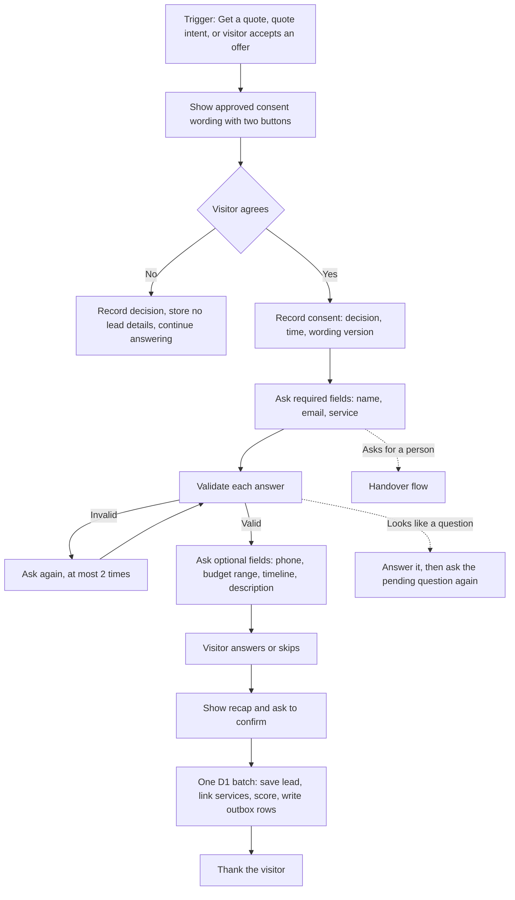

### 10.2 Fields and validation

| Field | Required [SRS FR-042, confirmed by management] | Validation [DESIGN-DEFAULT] |
|---|---|---|
| Name | Yes | Not empty; length limit |
| Email | Yes | Valid format; length limit; stored in lower case |
| Service | Yes | Must be an active service; pre-filled from the conversation tags (SRS FR-035) |
| Consent | Yes | Recorded before any other field |
| Phone | Optional | International format accepted; digits and a leading plus; country format rules **TBD-37** (the field list itself is decided) |
| Currency | Set before the budget question | PKR or USD [MGMT]. **Pre-selected from the browser's time zone** (Asia/Karachi → PKR, otherwise USD), with a visible switch. No IP address or location lookup is used (SRS DR-024). [DESIGN-DEFAULT, DEC-18] |
| Budget range | Optional | One of the active ranges **in the chosen currency** (values **TBD-38**) |
| Timeline | Optional | One of the active options (**TBD-38**) |
| Description | Optional | Length limit; masked like all text |

### 10.3 Scoring (the lead priority rule)

Scoring is a **pure function** with no AI and no network call. The same inputs always give the same result (SRS FR-054).

| Priority | Rule (SRS BR-004 to BR-006) | Data it reads |
|---|---|---|
| **Hot** | A phone number **and** a budget range that meets the Hot threshold **and** a timeline within 3 months (SRS BR-004 v0.3). Every saved lead already has name, email and service, so a Hot lead always holds the Warm details | `budget_range.meets_hot_threshold`, `timeline_option.within_3_months`, phone |
| **Warm** | Name, email and a chosen service | Fields |
| **Cold** | Anything less, for example a callback request with contact details but no service | Fields |

- The **Hot threshold** is set by management later, **in both PKR and USD** (**TBD-18**). Until it is set, no range meets it and no lead is Hot; the dashboard shows "Hot threshold not set" [DESIGN-DEFAULT]. The comparison method is **TBD-38**; the proposal is that a range counts when its **minimum** is at or above the threshold for its currency. When a threshold changes, the `meets_hot_threshold` flags are recomputed.
- The mapping of the client's descriptive Hot attributes to fields is proposed in SRS BR-009 (service and description, budget, timeline, phone); client confirmation is **TBD-39**.
- Scoring runs again whenever a lead is updated (SRS FR-055). The test suite covers the full truth table (SRS AC-030).

### 10.4 Duplicates and timing

| Topic | Design | Status |
|---|---|---|
| Same email submitted again | The design can **update the existing lead** or **create a new lead**. Proposal: update, and alert only if the priority rises. | **TBD-17** |
| When the alert fires | Hooks exist for: (a) the visitor confirms the recap; (b) the cron sweep closes a partly finished lead after an idle period; (c) a priority rise. Proposal: (a), plus (b) for leads that have consent and the required fields. | **TBD-41, TBD-42** |
| Callback submissions as leads | **Decided [MGMT]:** every callback submission creates a lead (`source = callback`), scored by the same rule (Cold if no service), and counts toward the 5 percent target (SRS FR-129) | Decided |

### 10.5 Notification architecture (MOD-11)

The **outbox pattern** guarantees that an alert is never lost: the lead and its notification rows are written in the **same D1 batch** (atomic). The Queue delivers them; an every-minute cron sweep covers a failed enqueue or a message the Queue dropped (DEC-B06).

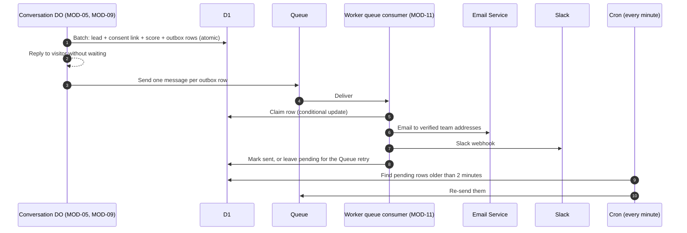

#### Events and recipients

| Event | Channels | Priority | Recipients | SRS |
|---|---|---|---|---|
| New lead (Warm or Cold), including callback leads | Email, Slack | Normal | Info@tricoredigitaltech.com and the sales and management team | FR-058, FR-062 |
| New Hot lead | Email, Slack | Urgent (format **TBD-55**) | Same | FR-059 |
| Handover requested | Email, Slack, staff-app queue | Urgent | Sales team (**TBD-44**) | FR-064 |
| Callback submitted | Email, Slack | Normal or urgent (**TBD-44**) | Sales team | FR-064 |
| Spending at 80 percent, and at the limit | Email | Warning | **TBD-47** | FR-159 |
| Alert undeliverable | Staff-app banner; developer alert | Critical | Staff; developer (**TBD-25**) | FR-066 |
| Backup or deletion job failed | Developer alert | Critical | Developer | EXC-023 |

Individual addresses and the Slack channel: **TBD-07**. Email: Cloudflare Email Service (TBD-06, provisional); every recipient must be a **verified address** (below).

#### Content (SRS FR-060)

Every lead alert carries: name and contact details; project requirements; interested services; lead priority; a conversation summary; a link to the conversation. The link opens the staff app and needs sign-in.

| Choice | Design |
|---|---|
| Full chat or summary plus link | **Summary plus link** (SRS FR-061, default adopted); the full chat stays in the staff app behind sign-in. TBD-13 reopens only if management asks for the full chat. The summary still holds name and contact details, so the legal review (TBD-53) must accept it |
| Summary text | A **template** built from the lead fields and the visitor's description (DEC-17). The AI summary (AI-3) is a setting; if it is on and fails, the template is used (SRS FR-061) |
| Safe display | All visitor text is escaped for email and Slack so it cannot add formatting, mentions or links (SRS FR-151) |
| Urgent mark | A subject prefix and a Slack mention are possible; the format is **TBD-55** |

#### Delivery rules

| Rule | Design |
|---|---|
| Unique key | Each row has a key built from the event type, the record ID and its version. A retry or a repeated event cannot create a second row (SRS FR-067). The consumer marks a row sent only once (conditional update), so a repeated Queue delivery sends nothing twice. |
| Independence | Email and Slack are separate rows. One failing does not stop the other (SRS FR-065). |
| Retries | Queue retries with a delay per attempt [DESIGN-DEFAULT]: after 30 seconds, 2 minutes, 10 minutes, 30 minutes and 2 hours (5 attempts). **The number of attempts is TBD-20.** |
| 24-hour retention [LIMIT] | The Queue drops messages older than 24 hours on Free. The D1 outbox row still exists, so the cron sweep re-sends it or marks it undeliverable. |
| Email recipients | **Only verified addresses** in Cloudflare Email Routing: Info@tricoredigitaltech.com and named team members (each clicks a verification link once; up to 200 addresses). |
| Sender | `assistant@tricoredigitaltech.com`, on the domain's Email Routing |
| Email prerequisite | `tricoredigitaltech.com` DNS on Cloudflare (free plan) with Email Routing on (TBD-72, provisional yes). If DNS cannot move: a free transactional email tier (for example Brevo, about 300 emails a day) through the same adapter. |
| End state | After the last attempt the row becomes `undeliverable`, shows in the staff banner and goes to the developer (SRS EXC-010). |
| Manual retry | Staff can retry an undeliverable row |
| Test mode | Rows are marked `captured` and never sent (Section 6.9) |

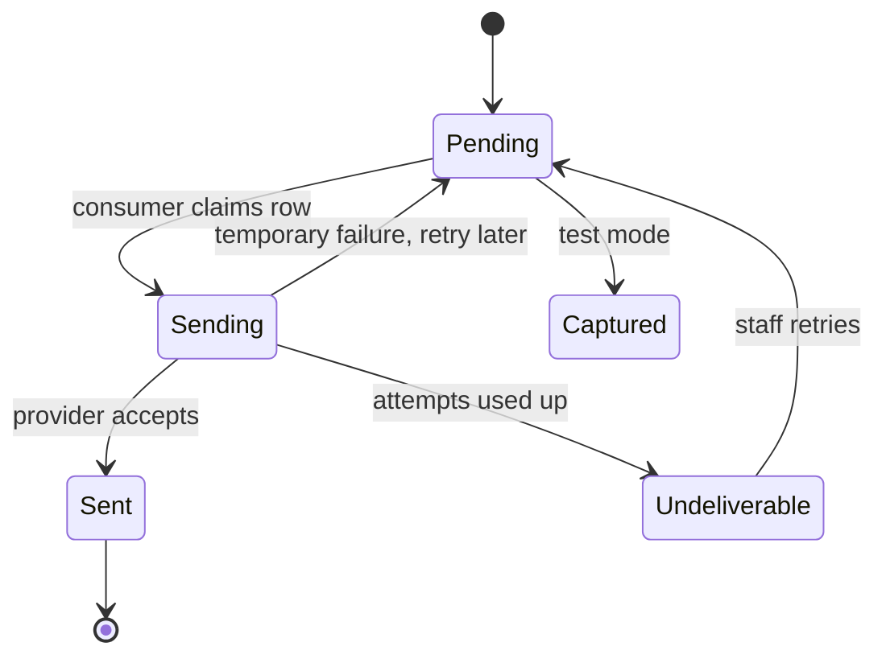

### 10.6 Callback requests

A callback submission stores consent, the callback request, **a lead with `source = callback`** and its score, and the outbox rows in one D1 batch (SRS FR-078, FR-079, FR-064, FR-129). The form fields are **TBD-40**.

---

## 11. Human handover implementation

### 11.1 Request lifecycle

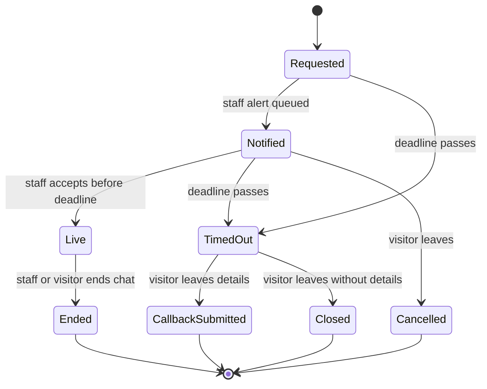

### 11.2 Sequence

```mermaid
sequenceDiagram
  autonumber
  participant V as Visitor widget
  participant C as Conversation DO (MOD-10)
  participant D as D1
  participant H as StaffHub DO
  participant N as Queue and MOD-11
  participant S as Staff app
  participant CR as Cron (every minute)

  V->>C: Ask for a person
  C->>C: Working hours check in PKT (9 to 7, Monday to Friday)
  alt Outside working hours
    C-->>V: Show callback form now
  else Inside working hours
    C->>D: Batch: request (deadline = now + 180 s) + outbox rows
    C->>C: Set alarm at the deadline
    C->>H: New waiting request
    H-->>S: Push to staff (WebSocket)
    C->>N: Email and Slack alerts
    C-->>V: Notified, up to 3 minutes
    alt Staff accepts in time
      S->>C: Accept (succeeds only if still Notified)
      C->>C: Delete alarm; stage = LIVE_CHAT
      C-->>V: Team member joined
      Note over V,S: Messages relay through the DO; AI silent
    else Alarm fires at the deadline
      C->>D: Set TimedOut
      C-->>V: Show callback form
      C->>H: Request expired
    end
  end
  CR->>D: Backstop: find requests past their deadline
```

### 11.3 How the rules are implemented

| Rule | Implementation | SRS |
|---|---|---|
| Working hours | Hours and days are settings, evaluated in PKT at the moment of the request: 9:00 AM to 7:00 PM, **Monday to Friday** [MGMT]. On Saturday and Sunday the callback form is shown at once. Public holidays: an Admin switch "callback only today" [DESIGN-DEFAULT] | FR-070, FR-071 |
| Three minutes | `deadline_at` is stored when the request is created (request time plus 180 seconds), and a **Durable Object alarm** is set for that moment. The timer runs **on the server, not in the browser**; the alarm fires even if no browser is connected and is retried by the platform if its handler fails. | FR-072, FR-073 |
| Backstop | The every-minute cron finds requests in D1 past their deadline (covers an alarm failure) and times them out. The same check runs on any event for the chat, including a WebSocket reconnect, so a missed alarm cannot leave a visitor waiting. | EXC-011 |
| Cron health | The cron sweep writes a heartbeat to `job_run`. A missing heartbeat alerts the developer. | EXC-011 |
| First to accept wins | The Conversation DO processes one accept at a time and accepts only while the status is still Notified. Others receive `409`. | FR-075 |
| One open request | A unique rule on conversations with an open request | FR-074 |
| AI silent in live chat | The conversation stage is `LIVE_CHAT`, and the engine relays instead of calling the model | FR-076 |
| Works without AI | The handover path calls no AI module | FR-077 |
| Outcome record | Joined, timed out, callback submitted or cancelled | FR-080 |

### 11.4 Live chat relay (MOD-10)

- **Visitor to staff:** the message reaches the Conversation DO (WebSocket or HTTP), is masked and stored in D1, and is forwarded to the StaffHub DO, which pushes it to the staff member's socket.
- **Staff to visitor:** the staff app posts to `POST /staff/handovers/{id}/messages`; the Worker passes it to the Conversation DO, which masks, stores and pushes it to the visitor's socket.
- **Order and reconnect:** each message has a sequence number. A reconnecting client sends its last sequence number and receives what it missed.
- **Fallback:** if WebSockets are blocked, both clients poll every 4 seconds.
- **Masking:** staff text and visitor text are masked like all other text.
- **Capacity:** at the planned volume the number of simultaneous live chats is tiny. With hibernation, open sockets cost no duration while idle; incoming WebSocket messages count at 20:1 toward the Durable Objects request limit [LIMIT].

### 11.5 Staff notification (SRS FR-082)

A new request creates outbox rows (email and Slack) **and** a push through the StaffHub WebSocket, which shows a visible waiting indicator in the staff app. Which channel staff must watch, and who is on duty, is **TBD-44**.

### 11.6 Edge cases

| Case | Implementation | Status |
|---|---|---|
| Staff join after the deadline | Allowed only if the visitor is still connected; otherwise the callback stands | **TBD-45** |
| Messages while waiting | Stored and shown to staff; the assistant sends only a reassurance | Design |
| Visitor leaves while waiting | Request set to cancelled; if contact details are known a callback alert is still sent | Design |
| Request at 6:59 PM | Availability judged at request time; the deadline can pass 7:00 PM | SRS FR-070 |
| After a live chat ends | Return to the assistant or offer a callback | **TBD-45** |
| Visitors in other time zones | Hours judged in PKT; display to visitors | **TBD-46** |
| Relay failure | Callback form; staff and developer alerted | SRS EXC-012 |
| Abusive visitor | Staff can end the chat | SRS FR-081 |

---

## 12. Dashboard architecture

### 12.1 Approach

The dashboard is a set of **direct D1 queries on the main tables** (MOD-14). At about 3,000 chats a month there is no need for a separate analytics store or summary tables. Revisit if volume grows by an order of magnitude or if a query exceeds its time budget (SRS NFR-003, TBD-51).

### 12.2 Metric definitions

| # | Dashboard item | Definition used by the query | Open point |
|---|---|---|---|
| 1 | Chats | Non-test conversations with at least one visitor message that started in the range | Exact definition **TBD-43** |
| 2 | Leads, Hot / Warm / Cold | Non-test leads created in the range (chat and callback leads [MGMT]), grouped by priority | |
| 3 | Share of chats that became leads | Leads (chat plus callback) divided by chats (zero if no chats); shown beside the 5 percent target | Chat definition **TBD-43** |
| 4 | Times a person was asked for | Count of handover requests and direct callback requests in the range | |
| 5 | Top 10 questions | Visitor questions grouped by `topic_tag`, with one example each, top 10 by count. The topic list is fixed and the model must choose from it. | Grouping rule **TBD-62** |
| 6 | Questions the assistant could not answer | Unanswered questions grouped by topic with an example | |
| 7 | Services visitors ask about most | Count of service tags across conversations | |
| 8 | AI spending and cost per lead | Month-to-date estimate from `spend_month` against the limit; cost per lead = cost in the range (from `ai_usage`) divided by leads in the range | Limit **TBD-21** |

### 12.3 Dates and time zone

The date filter works in **PKT** (SRS DR-023). Day boundaries are converted to UTC for the query. "Last 7 days" and "last 30 days" mean that many full days ending today (inclusive). Custom dates are inclusive.

### 12.4 Performance design

- Indexes on `conversation(started_at)`, `lead(created_at)`, `message(conversation_id, seq)`, `ai_usage(created_at)`, `handover_request(requested_at)`, with the test flag excluded by a partial condition.
- Results are cached for 60 seconds in the Worker's Cache API to save D1 reads.
- The CSV is built in the browser from pages of 500 leads, so no Worker request does heavy work (Section 2.6).

### 12.5 CSV export (SRS FR-107)

Built **in the browser** from the paginated leads API. All lead fields, priority, time created, consent decision and wording version, and services. **Spreadsheet formula injection protection:** any cell that starts with `=`, `+`, `-` or `@` is prefixed so that it is treated as text. UTF-8 with a byte-order mark so common spreadsheet programs open it correctly. Who may export is **TBD-48**.

### 12.6 Out of scope

No charts over time, trends, comparisons or emailed reports (SRS FR-127, OUT-09 to OUT-12). The queries are written so that Phase 3 can reuse them.

### 12.7 Verification

A prepared **reference dataset** with known answers is loaded in a local D1. Each of the eight items must match the expected value exactly (SRS AC-055).

---

## 13. Security and privacy

### 13.1 Threats and controls

| Threat | Control | SRS |
|---|---|---|
| Bots and spam run up the AI bill | Turnstile, rate limits, message size limit, daily cap, spend gate | FR-148, FR-149, FR-164 |
| Visitor tries to make the AI break its rules | Untrusted-input delimiting, no model tools, schema-limited output, Answer Guard, strike counter | FR-150, AIR-014 |
| Invented prices or promises | Retrieval, grounded prompt, rule check on every reply | AIR-004, EXC-006 |
| Visitor text attacks staff or Slack (markup, links, commands) | Output escaping everywhere, content security policy, CSV formula protection | FR-151 |
| Unauthorised access to the staff area | Cloudflare Access, JWT check in the Worker, deny-by-default RBAC, session length, audit log | NFR-010, NFR-011 |
| Leaked keys | Server-side secrets, no keys in the browser or logs, rotation procedure | NFR-013 |
| Card or password numbers stored or sent on | Masking at the entry point before storage and before the AI | FR-147, DR-022 |
| Personal data kept too long | Scheduled deletion; logs hold no visitor text | FR-152, FR-153 |
| Data lost | D1 Time Travel, daily encrypted export to R2, restore drill | FR-165, FR-166 |
| A flood uses up a daily free limit and stops the service | Turnstile, Cloudflare rate-limiting rule, app counters, hourly usage watch, fallback card | Section 2.5 |
| Cross-site attacks on visitors | Bearer tokens, strict CORS, iframe isolation, framing rules | Section 3.1 |
| Injection into the database | Parameterised queries through Drizzle and prepared statements; no string-built SQL (FTS5 query text is escaped) | NFR-011 |
| Vulnerable dependencies | Pinned versions, automated update alerts, a security scan in CI | Section 16 |

### 13.2 Where personal data flows

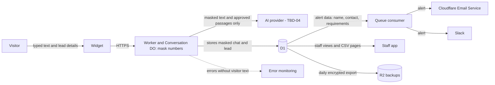

Cloudflare hosts the system and stores all data (a processor). Beyond Cloudflare, personal data goes to three places: the AI provider (masked chat text), Slack (alerts) and, if DNS cannot move, the fallback email service. The AI provider receives **no contact details** unless AI-2 or AI-3 is switched on. Terms for all of them are **TBD-53**.

### 13.3 Masking design (MOD-04)

| Item | Design |
|---|---|
| Where | Applied to every inbound text: visitor messages, lead fields, callback notes, and staff live-chat text. It runs **before** storage and **before** the text can reach the AI provider. |
| What | **Card-like** numbers (13 to 19 digits with common separators, confirmed by a checksum) and **password-like** text (a password or passcode keyword followed by a value). The exact pattern list lives in the repository and is covered by examples that must and must not match. |
| Result | The matched text is replaced by a marker such as "[hidden]". The assistant replies that card and password details must not be shared (SRS FR-048). |
| Trade-offs | False positives (a long reference number looks like a card) are accepted over a leak. The AI-4 vector option, if enabled, receives masked text only. |
| Limit | Masking catches patterns, not every sensitive thing a visitor could type. The consent and notice wording should say so (**TBD-36**). |

### 13.4 Privacy design

| Topic | Design | Status |
|---|---|---|
| Consent before lead details | Section 10.1; recorded with the wording version | SRS FR-037, FR-039 |
| Consent wording | Stored in `consent_text`; approved by management before launch | **TBD-36** (SRS BR-011) |
| Notice that chats are stored and reviewed | A notice in the widget if the legal review requires it | **TBD-36** |
| Data minimisation | Only the fields in SRS DR-004 and DR-006 plus the masked chat; **no IP address or browser string is stored** | SRS DR-024 |
| IP addresses | **Not used by the application.** Rate limits use session and day counters in D1, plus a Cloudflare rate-limiting rule that runs at the edge before the Worker (provisional) | **TBD-68** |
| Retention | 90 days for chats, 12 months for leads (proposed) | **TBD-36**, SRS BR-027 |
| Visitor rights requests (for example access or deletion) | A manual, documented procedure that finds a lead by email and exports or deletes it. Which rights apply and how fast: **TBD-53.** | **TBD-53** |
| Processors | Cloudflare (hosting, database, email, Access), the AI provider, Slack, Sentry and GitHub (backup runner) are processors. Written terms are needed. | **TBD-53** |
| Where data is stored | Cloudflare's network; D1 location hint `weur` and R2 jurisdiction `eu` (provisional, TBD-54); effect on visitors in the UK, Australia, Canada and elsewhere | **TBD-53, TBD-54** |
| AI statement | The widget states that it is an AI assistant | SRS FR-009, TBD-30 |
| Storage in the browser | The widget keeps a session token. Whether that needs a notice depends on the legal review. | **TBD-53** |
| Free AI services | Never used with real visitor data | SRS FR-156 |

### 13.5 Secrets and rotation

- Keys are held in Worker secrets, one set per environment (staging is a separate account).
- A written procedure lists each key, who may rotate it, and how to do it without downtime.
- A suspected leak means: revoke at the provider, issue a new key, redeploy, review the logs.
- The owner for security incidents is **TBD-25**; any duty to notify authorities or visitors is **TBD-53**.

### 13.6 Hardening checklist

Transport encryption with modern settings and HSTS; security headers (content security policy, frame rules, content-type protection, referrer policy); cross-origin allow-list; Cloudflare account roles and API tokens with least privilege (tokens scoped to this Worker, D1 and R2); no debug mode in production; dependency scanning in CI; backups encrypted; production access logged.


---

## 14. Error handling and logging

### 14.1 Principles

1. Every failure ends in a **visitor-safe fallback**: a polite message and a way forward (a person, the callback form or the company email).
2. **Fail closed** for safety and cost: if a safety check or the spend check cannot run, AI is switched off rather than allowed to run unchecked.
3. **Never lose a lead silently** (SRS NFR-007).
4. Errors are logged with a request ID and the module that raised them, and the right person is alerted (Section 14.8).

### 14.2 Service modes

| Mode | Entered when | Behaviour | Left when |
|---|---|---|---|
| **Normal** | All healthy | Full assistant | |
| **Degraded** | A single AI call keeps failing, or the circuit breaker is open for one task | Scripted flows and quick buttons; handover works | The breaker closes after a successful trial call |
| **Details only** | Spending limit reached, spend counters unreadable, or the AI provider is down | "Please leave your details" flow; no AI call | The month resets, the limit is raised, the provider recovers, or the counters are readable again |
| **Static fallback** | The API cannot be reached, or returns `capacity_reached` | The widget shows the fixed message and the company email (SRS FR-010, FR-168) | The API is reachable (daily limits reset at 05:00 PKT) |

Mode changes are written to the log, and entering Details only or Static fallback alerts the developer.

### 14.3 Handling of each exception scenario

| EXC | Detection | Mechanism | Escalation |
|---|---|---|---|
| EXC-001 | Provider error or timeout | One retry; then a fallback reply with a person offer; the circuit breaker opens after repeated failures and mode changes to Details only | Developer alert |
| EXC-002 | Result fails schema validation | Discard, retry once, otherwise as EXC-001 | Logged; developer if frequent |
| EXC-003 | `intent` unclear or low confidence | One clarifying question, then quick buttons, then a person (limit TBD-28) | None |
| EXC-004 | No passage above the threshold, or `answerable` is no | Fixed not-sure reply; question saved as unanswered | Dashboard list; weekly review |
| EXC-005 | Content search fails | Treat as EXC-004; keep serving the last live release | Staff and developer alert |
| EXC-006 | Answer Guard rejects a reply | One regeneration, then a fixed safe reply | Logged for the weekly review |
| EXC-007 | D1 health check or write fails | The API returns a service error; the widget enters Static fallback | Critical developer alert; management informed if long |
| EXC-008 | Lead D1 batch fails | Retry; if it still fails, ask the visitor to email the company and write the details to a protected error record | Staff and developer alert |
| EXC-009 | One channel fails | Other channel still sends; failed row retries | Banner in the staff app |
| EXC-010 | Both channels fail after the last attempt | Row set to undeliverable; lead stays saved | Staff banner; developer alert |
| EXC-011 | Overdue handover found by the alarm or the cron backstop | Set timed out; callback form shown | Developer alert if the cron heartbeat is missing or the backstop found one the alarm missed |
| EXC-012 | WebSocket or relay fails | Callback form shown; polling fallback tried first | Staff and developer alert |
| EXC-013 | Deadline passes with no staff | Callback form (normal rule, not an error) | Sales alert for the callback |
| EXC-014 | Outside working hours | Callback form at once | Alert for the next working period |
| EXC-015 | Month-to-date cost reaches the limit | Details only mode; a warning was sent at 80 percent | Email warning (TBD-47); management decides |
| EXC-016 | Spend counters unreadable | **Fail closed** to Details only | Developer alert |
| EXC-017 | Bot check fails or limit exceeded | Block with `403` or `429`; no AI call | Logged |
| EXC-018 | Turnstile cannot be reached | Behaviour **TBD-15**; proposal: allow with a stricter rate limit | Developer alert |
| EXC-019 | Abuse or injection intent | Safe refusal; strike counter; end the topic after the limit | Logged for the trick-test review |
| EXC-020 | Consent decision is no | No lead data stored; assistant continues | None |
| EXC-021 | Visitor leaves during collection | Handling **TBD-42** | |
| EXC-022 | Widget script fails to load | The website continues; a health probe loads the widget on a schedule | Developer alert |
| EXC-023 | Job fails (retention, backup) | Retry at the next run; never skip silently | Developer alert |
| EXC-024 | A test run stops early | Run marked incomplete; content change not treated as verified | Staff and developer alert |
| EXC-025 | Staff app unavailable | Visitor chat and alerts continue; handover moves to the callback form at the deadline | Developer alert |
| EXC-026 | Empty or too-long message | `400` or `413` with a polite request to shorten | None |

### 14.3a Scenarios specific to Cloudflare

| Scenario | Handling | Escalation |
|---|---|---|
| A daily free limit is reached (requests, D1, Durable Objects, Queue) | API returns `capacity_reached`; widget shows the fallback card with the company email; service resumes by itself at 05:00 PKT | Developer alert; repeated hits → move to Workers Paid (DEC-B10) |
| A request exceeds 10 ms CPU | Logged with its route; the widget retries once; the CI CPU budget prevents most cases (Section 2.6) | Developer |
| Queue message dropped after 24 hours | Cron sweep re-sends from the D1 outbox or marks the row undeliverable | Staff banner if undeliverable |
| Durable Object alarm fails | Cron backstop times out overdue handovers | Developer alert |
| D1 database near 500 MB | Alert at 70 percent; check retention jobs | Developer |
| Usage watch | Hourly cron reads account usage through the Cloudflare API, stores `usage_snapshot`, alerts at 60 percent of any daily cap | Developer |

### 14.4 Timeouts and retries [DESIGN-DEFAULT, tuned after NFR-001, TBD-51]

| Call | Timeout | Retries |
|---|---|---|
| AI provider | Set so that the visitor's reply stays within the reply-time target | 1 retry on transient errors |
| D1 | Short per query | A batch is retried once on a transient error |
| Email and Slack | Short per attempt | Per the outbox schedule (Section 10.5) |
| Turnstile verify | Short | None (EXC-018 rules) |

### 14.5 Logging

| Topic | Design |
|---|---|
| Format | Structured JSON written with `console`, collected by Workers Logs (free allowance and retention; confirm) |
| Correlation | Every line carries `request_id`, and where known `session_id`, `conversation_id`, `turn_id`, `module` |
| What is logged | Requests (method, route, status, duration); stage transitions; AI calls (task, model, mode, tokens, latency, outcome); retrieval scores; outbox attempts; cron and job runs; mode changes; sign-ins; errors with stack traces |
| What is **never** logged | Visitor message text, lead and callback details, session tokens, Access JWTs, provider keys, webhook addresses |
| Levels | Error for failures that need action; warning for fallbacks; info for normal events; debug off in production |
| Separate audit trail | Staff actions go to `change_log` in the database (SRS FR-090) |
| Retention | Application log retention and backup retention: **TBD-71** |
| Error monitoring | A free-tier service receives exceptions with no visitor text (SRS IR-009) |

### 14.6 Health and monitoring

| Signal | Check | Alert when [DESIGN-DEFAULT, TBD-51] |
|---|---|---|
| Liveness and readiness | `/healthz`, `/readyz` (D1 reachable) probed from outside | Failing for a few minutes |
| Outbox backlog | Age of the oldest pending row | Older than a few minutes |
| Cron sweep | Heartbeat in `job_run` | Missing for a few minutes |
| AI failures | Failure rate and breaker state | Breaker open, or a high failure rate |
| Spend | Month-to-date against the limit | 80 and 100 percent (customer-facing alerts per SRS FR-159) |
| Widget availability | A scheduled load of the widget script | Fails |
| Jobs | Retention and backup results | Failed or missing |
| Free-tier usage | Requests, D1 reads and writes, Durable Objects, Queue (hourly usage watch); D1 size | 60 percent of any daily cap; D1 at 70 percent of 500 MB |
| CPU time | p99 CPU per route in Workers metrics | Above 7 ms |

### 14.7 Escalation (workflow document, Section 14.4)

| Level | What | Who |
|---|---|---|
| L0 | Automatic retry and fallback | The system |
| L1 | Visitor-facing fallback | The system |
| L2 | Staff alert about a lead, handover, callback or unanswered question | Sales and management team |
| L3 | Developer alert for faults | Developer (owner **TBD-25**) |
| L4 | Management decision (limit, content, legal) | Management |

### 14.8 Runbooks to write before launch

AI provider outage; D1 unavailable; alert backlog; spending limit reached; restore from Time Travel and from an R2 export; rotating a key; cron stopped; content release rolled back; daily free limit reached and moving to Workers Paid.

---

## 15. AI usage tracking and cost controls

### 15.1 What is recorded

One `ai_usage` row for **every** model call: conversation, purpose (turn, summary, lead assist, embedding, test), model, mode (budget or premium), input and output tokens, estimated cost, latency, status, prompt version, and whether it was a test call (SRS DR-016).

### 15.2 Estimating cost

- An **admin-maintained price table** (a setting) holds the price per unit of input and output for each model.
- Estimated cost is the recorded usage multiplied by the table price. It is an **estimate, not an invoice**.
- A monthly check compares the estimate with the provider's usage figures. The accepted tolerance is **TBD-51** (SRS AC-073).
- Changing the price table is logged in `change_log`.

### 15.3 The budget gate (MOD-12)

| Step | Action |
|---|---|
| 1 | Before every model call, read the month-to-date estimate for **real** (non-test) usage from `spend_month`. Test calls use the separate test budget (SRS FR-144). |
| 2 | Add the largest cost this call could have (its maximum tokens times the price) as a reservation with one atomic `UPDATE spend_month SET reserved = reserved + ? WHERE …` that succeeds only if the total stays under the limit, so concurrent calls from different chats cannot jointly overshoot |
| 3 | If the total would pass the limit, deny the call and switch to Details only mode |
| 4 | After the call, replace the reservation with the real estimate |
| 5 | When the total first reaches **80 percent** in a month, queue **one** warning (a unique key per month) (SRS FR-159) |
| 6 | At **100 percent**, set Details only mode until the month ends or an Admin raises the limit |
| 7 | **If any step cannot read or write its data, deny the call (fail closed)** (SRS FR-162) |

The **amount of the monthly limit is TBD-21** (management approval required). P1 v0.4 suggests $100 (about Rs 28,000) for budget mode, or about $200 for premium mode at 3,000 chats, because premium AI usage at that volume is $120 to $180. This SDD does not apply either; the limit is set together with the mode (TBD-10). For building and testing, `DECISIONS_APPLIED.md` uses $100 provisionally.

### 15.4 Cost controls

| Control | Design | Status |
|---|---|---|
| Monthly limit and warning | Section 15.3 | Amount **TBD-21**; recipients **TBD-47** |
| Per-visitor and daily limits | Counters per session and per day, checked before any model call | Values **TBD-14** |
| Message and reply size | Maximum characters in; maximum tokens out | Values **TBD-14** |
| One model call per message | AI-1 combines intent, answer and guidance (DEC-05) | Design |
| No call when no call is needed | Buttons, greetings, scripted lead steps, live chat, not-sure replies from retrieval | Design |
| Model choice | Budget mode by default; premium mode only for messages the rule marks as hard | Rule **TBD-10** |
| Context limits | Last 6 messages and top 4 passages | DEC-16 |
| Provider caching | Use the provider's prompt caching where offered, to cut the cost of repeated rules and the service list | Option |
| Circuit breaker | Stops calls to a failing provider | Section 4.2 |
| Test budget | A test limit applies to testing (P1 suggests $20) | SRS FR-144, TBD-70 |

### 15.5 Reporting

The dashboard shows month-to-date estimated spend against the limit and the cost per lead (SRS FR-125). Admins can also see cost per conversation and per model, and real versus test spend.

### 15.6 AI cost at the planned volumes

The figures are **P1 unit costs multiplied by volume** (1 to 2 cents per chat in budget mode, 4 to 6 cents in premium mode). They are estimates and must be re-checked before the budget is approved.

| Chats per month | AI cost, budget mode | AI cost, premium mode |
|---|---|---|
| About 500 | $5 to $10 | $20 to $30 |
| About 3,000 | $30 to $60 | $120 to $180 |
| About 15,000 | $150 to $300 | $600 to $900 |

Infrastructure adds $0 on free plans, so these are also the total monthly costs (Section 18.3).

---

## 16. Testing strategy

### 16.1 Levels

| Level | What it proves | Tools | When |
|---|---|---|---|
| **Unit** | Business rules: scoring truth table, masking examples, validation, state-machine transitions, budget gate, retention selection, CSV protection | Vitest | Every commit |
| **Integration** | Modules in the real Workers runtime with local D1, Durable Objects and Queues: lead plus outbox in one batch, one-at-a-time DO processing, first-to-accept, alarm and cron backstop, retention batches, migrations on a fresh D1 | Vitest with the Cloudflare Workers test pool | Every commit |
| **Contract** | The model result schema against recorded sample results; the API against its OpenAPI description | Vitest, Zod schemas | Every commit |
| **End to end** | Widget and staff app flows in a browser: the five practice situations, consent, lead, handover, callback, offline notice | Playwright | Every merge |
| **AI evaluation** | Answer quality, grounding, guidance, safety, retrieval, cost, latency with a real model | The evaluation harness (16.3) | Before launch; after any change to model, prompt or content |
| **Load** | The 3,000-chats-a-month profile and many chats at once; request counts per chat compared with the free limits | k6 against staging | Before launch |
| **CPU budget** | p99 CPU per route | Workers metrics in staging; CI fails above 7 ms | Every release |
| **Free-limit drill** | A simulated `capacity_reached` response shows the widget fallback card | Playwright | Before launch |
| **Security** | Authorisation matrix (with and without a valid Access JWT), injection, rate limits, headers, dependency and secret scans | Vitest, scanners | CI; before launch |
| **Failure injection** | Each exception scenario by switching a dependency off | Scripts, test toggles | Before launch |
| **Acceptance** | The SRS acceptance criteria and the release checklist | Manual and automated | Before launch |

### 16.2 Environments and data

- **Made-up data only** in tests (SRS FR-142); the seed pack in `doc/08-seed/` supplies dummy content and the 86 test questions.
- **Staging uses a separate free Cloudflare account**, so testing never uses up production's daily limits (DEC-B09).
- A **fake AI provider** with fixed results makes most tests free and repeatable.
- A **test mode** flag on conversations sends no real alerts and creates no real leads (SRS FR-141).
- The AI evaluation uses the real model with a small, capped test budget (P1 suggests $20, **TBD-70**). Free provider tiers may be used for practice with made-up data only.

### 16.3 AI evaluation harness (MOD-15)

| Set | Content | Pass rule | SRS |
|---|---|---|---|
| **50-question set** | 50 questions with approved answers written by the TriCore team | At least 45 correct, on each of three runs | BR-021, AC-058 |
| **Retrieval set** | The same questions mapped to the entry that should answer them, plus paraphrases | Recall at 4 reported; used for the vector decision (Section 5.6) | TBD-51 |
| **Grounding set** | Questions the content does not cover; cost questions; out-of-scope | 100 percent not-sure or quote-redirect; 0 invented prices, clients, promises | AC-014 to AC-016 |
| **Guidance set** | Undecided-visitor messages | Recommendations only from the service list and content | AC-019 to AC-021 |
| **Trick set** | Requests for secrets, off-topic, rude, injection attempts | 100 percent safe and polite | AC-060, AC-068 |
| **Size of the non-50 sets** | | **TBD-63** | |

Judging "correct" is done by a human reviewer; an AI judge may assist only if management approves it (**TBD-23**). Every run stores the release, prompt version, model and mode, and its cost, so results can be compared over time. Any change to the model, the prompt or the content triggers the harness (SRS FR-097).

### 16.4 Where each kind of requirement is tested

| Requirement area | Test type | Acceptance criteria |
|---|---|---|
| Scoring and lead rules | Unit | AC-030, AC-031 |
| Consent and fields | Unit, end to end | AC-023 to AC-029 |
| Masking and sensitive data | Unit, security | AC-065, AC-083 |
| State machine and routing | Unit, end to end | AC-008 to AC-010, AC-028 |
| Alerts and retries | Integration, failure injection | AC-032 to AC-036 |
| Handover and deadline | Integration, end to end | AC-037 to AC-043 |
| Permissions | Security (every route) | AC-044, AC-045, AC-087 |
| Knowledge workflow | Integration, end to end | AC-046 to AC-049 |
| Dashboard | Integration with a reference dataset | AC-054 to AC-057 |
| Retention and backups | Integration, drill | AC-070, AC-075, AC-076 |
| Spend control | Unit, integration | AC-071 to AC-074 |
| Answer quality and safety | AI evaluation | AC-013 to AC-022, AC-058 to AC-062, AC-068, AC-077 to AC-081 |
| Performance and capacity | Load | AC-084 to AC-086 |
| Browsers and accessibility | End to end | AC-088, AC-089 |
| Exceptions | Failure injection | AC-092 |

### 16.5 Load and capacity test

Profile: the planning volume of 3,000 chats a month, with a peak concurrency to be set (**TBD-51**), including open WebSockets and live chats. It runs against staging and also checks Workers requests, D1 rows and Durable Object requests per chat against the free limits. Real-model calls are replaced by a delayed fake for the bulk of the load, plus a small real-model sample to check latency and cost. Pass: no errors, no lost leads, and reply times within the NFR-001 target (SRS AC-084, AC-085).

### 16.6 Security testing

Authorisation matrix for every route; stored and reflected script payloads in chat, lead fields and callback notes; markup and mention injection into email and Slack; CSV formula cells; rate-limit and daily-cap bypass attempts; prompt-injection set; header, transport and CORS checks; dependency and secret scans in CI. An external penetration test is optional; its cost and need are for management (**TBD-53**).

### 16.7 Practice chats and acceptance

The TriCore team runs the five practice situations and signs off the results (SRS FR-135, FR-143). The staff time estimate is 10 to 15 hours (P1). The release checklist in SRS RAC-01 to RAC-11 is the go-live gate.

### 16.8 CI pipeline and gates

Format, lint and type checks; unit, integration and contract tests; migration test on a fresh local D1; build of widget and staff app; dependency and secret scan; end-to-end tests and the CPU budget check on staging on merge. A change is merged only when all pass. Coverage on the business-rule modules is tracked [DESIGN-DEFAULT target: 80 percent or more]; coverage is a guide, not the gate.

---

## 17. Deployment architecture

### 17.1 Environments

| Environment | Where | Purpose | Cost |
|---|---|---|---|
| Local | `wrangler dev` on the developer's machine (local Workers runtime, D1, Durable Objects, Queues); fake AI provider | Development | $0 |
| CI | GitHub Actions; a fresh local D1 per run | Automated tests | $0 within free minutes |
| Staging | A **separate free Cloudflare account** (DEC-B09); `*.workers.dev` address; real model with the test budget; alerts to a test Slack channel and a verified test inbox | Pre-launch tests, CPU budget, practice chats | $0 (AI test budget $20, TBD-70) |
| Production | TriCore's Cloudflare account (TBD-69); `assistant.tricoredigitaltech.com` | Live | $0 |

### 17.2 Deployment diagram

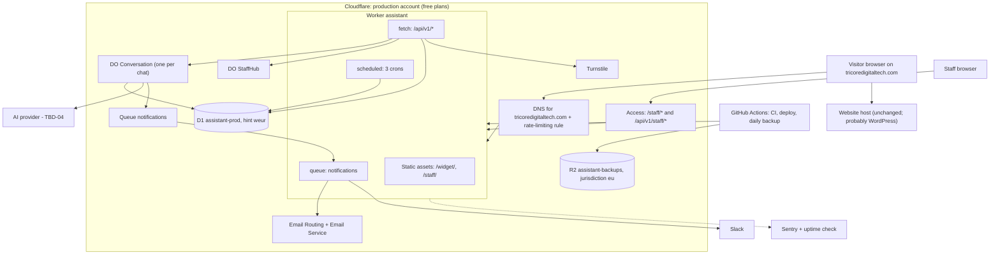

Only DNS moves to Cloudflare (TBD-72, provisional yes); the website itself stays with its current host. The widget is served from `assistant.tricoredigitaltech.com`, a **different origin** from the website, so the iframe isolation works.

### 17.3 Runtime

| Topic | Design |
|---|---|
| Packaging | One Worker (`apps/worker`) with static assets from the widget and staff app builds (`apps/widget`, `apps/staff`); shared types in `packages/shared` |
| Bindings (`wrangler.jsonc`, no secrets) | `DB` (D1), `CONVERSATION` and `STAFF_HUB` (Durable Object classes, SQLite-backed), `NOTIFY` (Queue producer and consumer), `BACKUPS` (R2), `EMAIL` (`send_email`), `ASSETS` (static assets) |
| Cron schedules (UTC) | Sweep `* * * * *` (outbox re-send, overdue handovers, idle close, heartbeat); retention `0 22 * * *` (03:00 PKT); usage watch `0 * * * *` |
| Secrets | `AI_API_KEY`, `SLACK_WEBHOOK_URL`, `TURNSTILE_SECRET`, `ACCESS_TEAM_DOMAIN`, `ACCESS_AUD`, `SENTRY_DSN` via `wrangler secret put`; locally in `.dev.vars` (never committed; `.dev.vars.example` lists names only) |
| Durable Object migrations | Declared in `wrangler.jsonc` with `new_sqlite_classes` (Free supports SQLite-backed objects only) |
| Health | `/healthz`, `/readyz` (D1 reachable), probed by the external uptime check |
| Time zone | The platform runs in UTC; working hours and dates are computed in `Asia/Karachi` |
| Restart | Nothing to restart: every request is a fresh invocation; durable state is in D1 and the Durable Objects |

### 17.4 Release pipeline

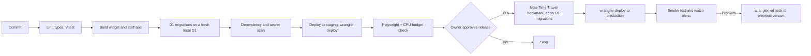

- **Migrations** are written to be compatible with the previous release (add first, remove later) and run **before** the new code is deployed, after recording a Time Travel bookmark.
- **Rollback** means `wrangler rollback` to the previous Worker version. If a migration must be undone, a forward fix is preferred; a Time Travel restore is the last resort.
- **Feature switches** (AI-2, AI-3, vector retrieval) are settings, so they can be turned on or off without a deploy.
- Who approves a release and who deploys: **TBD-25**.

### 17.5 Backup and recovery design (DEC-B07)

| Item | Design | Status |
|---|---|---|
| Point-in-time restore | D1 **Time Travel**: restore to any minute in the last 7 days, free (30 days on Workers Paid) | SRS FR-165 |
| Daily copy | GitHub Actions at 02:00 PKT runs `wrangler d1 export`, encrypts the file (age), and uploads it to R2 (`assistant-backups`, jurisdiction `eu`); writes a `backup_record` row | SRS FR-165 |
| Backup retention | 14 daily and 3 monthly copies (provisional); deleted records remain in backups until they expire | **TBD-71, TBD-53** |
| Restore drill | Before launch and monthly: import the latest export into a staging D1 and check row counts, leads and consent records | SRS FR-166, AC-076 |
| Targets | Maximum data loss: minutes within 7 days (Time Travel), one day beyond; restore within 2 hours (provisional) | **TBD-16** |
| Failure | A failed or missing daily backup alerts the developer (EXC-023) | Design |

### 17.6 Account ownership and one-time setup

Accounts: **who owns and pays for each is TBD-69.** The recommendation is that TriCore owns the Cloudflare, GitHub, AI provider, Slack and Sentry accounts and the developer receives scoped access, so the system survives a change of developer. Billing methods available in Pakistan may limit the choice of AI vendor (Cloudflare free plans need no card; R2 may ask for one).

| One-time item from TriCore | Why |
|---|---|
| Cloudflare account owned by TriCore (TBD-69) | Free plans; the developer gets a scoped role |
| Move `tricoredigitaltech.com` DNS to Cloudflare, free plan (TBD-72) | Custom subdomain for the assistant, Email Routing for alerts, rate-limiting rule. The website stays where it is hosted; only DNS moves |
| Verify each alert email address (one click each) | Email Service sends free only to verified addresses |
| Access policy: list of staff emails or the company domain | Staff sign-in |
| Slack incoming webhook | Alerts |
| Private GitHub repository | Code, CI, deploys and the backup job |
| AI provider account and key (TBD-04) | The only paid service |

If DNS cannot move: the assistant runs at `assistant.<account>.workers.dev`, and alerts use a free transactional email tier. Everything else is the same.

---

## 18. Infrastructure and estimated operational costs

### 18.1 Sources and caution

- **P1** unit figures: AI 1 to 2 cents (budget) or 4 to 6 cents (premium) per chat; Rs 280 per dollar; prices checked 18 October 2026.
- **Cloudflare documentation and third-party summaries** for free-tier limits and the Workers Paid price, read 12 November 2026. They change; re-check before launch.
- Lines marked **architect's estimate** are planning figures, not quotes.
- AI cost (TBD-04, TBD-21) must be confirmed with real usage in the 50-question runs before the budget is approved.

### 18.2 Monthly infrastructure

| Item | Cost |
|---|---|
| Workers, Durable Objects, D1, Queues, Cron Triggers, static assets | $0 (free plans, within the limits in Section 2.4) |
| Cloudflare DNS, Email Routing and Email Service, Turnstile, Access (up to 50 users) | $0 |
| R2 backups (under 10 GB) | $0 |
| GitHub (private repository, Actions minutes), Sentry, uptime check | $0 (free tiers) |
| **Infrastructure total** | **$0** |
| Optional insurance: Workers Paid (DEC-B10) | $5 a month; removes daily caps; no code change |

### 18.3 Total monthly cost by volume (infrastructure plus AI, USD)

| Chats a month | Budget mode | Premium mode |
|---|---|---|
| About 500 | $5 to $10 | $20 to $30 |
| About 3,000 | **$30 to $60** | **$120 to $180** |
| About 15,000 | $150 to $300 + likely $5 Workers Paid | $600 to $900 + likely $5 |

At 3,000 chats in rupees (Rs 280 per dollar, before tax): about **Rs 8,400 to 16,800** in budget mode and **Rs 33,600 to 50,400** in premium mode. The exchange rate changes; recalculate before budgeting.

**Compared with the Python design (Option A, not used):**

| | A1: one VPS | A2: app host + managed PostgreSQL | **This design** |
|---|---|---|---|
| Infrastructure a month | About $17 to $45 | About $27 (example: $12 app + $15 database) | **$0** (optional $5) |
| Total at 3,000 chats, budget mode | About $47 to $105 | About $57 to $87 | **About $30 to $60** |
| Saved per year compared with A2 | — | — | **About $324 (Rs ~90,000)** |
| Server administration | Most | Some | **None** |
| When limits are hit | Slows down | Slows down | **Stops until 05:00 PKT** (unless on the $5 plan) |
| Uptime guarantee | Provider's VPS terms | Managed database terms | **None on free plans** |
| Language | Python | Python | **TypeScript** |
| Lock-in | Low | Low | **Higher** (Workers, D1, Durable Objects, Queues) |

### 18.4 One-off and people costs

| Item | Estimate | Source |
|---|---|---|
| AI usage during testing | About $5 to $15 (cash for all testing about $5 to $30); test limit $20 | P1 §7.2, TBD-70 |
| Staging environment | $0 (separate free Cloudflare account) | DEC-B09 |
| Developer build fee | **Not included**; not stated | P1 §6.5, TBD-56 |
| Content writing | Not included (TriCore team, within 2 to 3 weeks [MGMT]) | P1 §6.5 |
| Legal and privacy review | Not included; cost unknown | TBD-53 |
| Developer maintenance | About 4 to 8 hours a month | P1 §6.3 |
| Weekly quality review | About 1 hour a week | P1 §6.3 |
| Content fixes | About 1 to 2 hours a month | P1 §6.3 |
| Staff time for testing | About 10 to 15 hours | P1 §7.2 |

### 18.5 Cost levers and their consequences

| Lever | Saves | Consequence |
|---|---|---|
| Budget mode by default | Most AI cost | Weaker on hard questions; decide by the 50-question test |
| Free plans instead of Workers Paid | $5 a month | Hard daily caps and no SLA (RISK-B01, RISK-B07) |
| No vectors | Embedding calls | May miss paraphrases; revisit by test |
| Template instead of AI summary | One call per lead | Alerts are less polished |
| Lower rate limits and shorter history | Spam, token cost and free-tier use | May reject heavy but honest users |
| Provider prompt caching | Repeated rules and service list | Depends on the provider (TBD-04) |
| Free AI provider tiers | Cash | Not allowed for real visitors (SRS CON-011): prompts may be logged or used for training |

---

## 19. Mapping of technical components to SRS requirements

Every functional, AI, data, interface, non-functional, exception and business-rule requirement in the SRS is covered below. Permissions (PRM) are mapped in Section 9.3 and exceptions (EXC) in Section 14.3. A scripted check confirmed that every ID appears (Section 19.7).

### 19.1 Functional requirements

| SRS requirements | Modules | SDD sections |
|---|---|---|
| FR-001 to FR-011 Chat widget | MOD-01, MOD-02, MOD-04, MOD-10 (handover status) | 3.1, 8.2 |
| FR-012 to FR-019 Conversation handling | MOD-05, MOD-06, MOD-04 (storage), MOD-16 (idle close) | 4, 6 |
| FR-020 to FR-028 Answers from approved content | MOD-05, MOD-06, MOD-07, MOD-08 | 4, 5 |
| FR-029 to FR-036 Service guidance | MOD-05, MOD-06, MOD-07 | 4.1, 5, 6.4 |
| FR-037 to FR-052 Consent and lead collection | MOD-05, MOD-09, MOD-02, MOD-11 | 10.1 to 10.4 |
| FR-053 to FR-057 Qualification | MOD-09, MOD-13 (threshold setting) | 10.3 |
| FR-058 to FR-068 Sales alerts | MOD-11, MOD-09, MOD-13 | 10.5 |
| FR-069 to FR-084 Handover and callback | MOD-10, MOD-05, MOD-11, MOD-16, MOD-13 | 11 |
| FR-085 to FR-091 Staff sign-in and roles | MOD-13, MOD-17 | 9 |
| FR-092 to FR-102 Knowledge management | MOD-07, MOD-13, MOD-03 | 5.3, 8.3 |
| FR-103 to FR-110 Leads, chats, live chat | MOD-13, MOD-10, MOD-14 | 8.3, 12.5 |
| FR-111 to FR-115 Settings | MOD-13 | 3.4 |
| FR-116 to FR-129 Dashboard | MOD-14, MOD-13 | 12 |
| FR-130 to FR-145 Quality assurance | MOD-15, MOD-13 | 16.3 |
| FR-146 to FR-151 Safety | MOD-04, MOD-05, MOD-06, MOD-08 | 4.6, 13 |
| FR-152 to FR-157 Privacy and retention | MOD-16, MOD-09, MOD-13 | 7.4, 13.4 |
| FR-158 to FR-164 Spending protection | MOD-12, MOD-06, MOD-04 | 15 |
| FR-165 to FR-168 Backup and unavailability | MOD-16, MOD-18, MOD-02 | 17.5, 14.2 |

Requirements where the Cloudflare platform shapes the design: FR-072 and FR-073 (three-minute server timer) use a Durable Object alarm with a cron backstop (11.3); FR-107 (CSV export) is built in the browser from the API (12.5); FR-165 and FR-166 (backups and restore) use Time Travel, a daily R2 export and a drill (17.5); FR-085 (staff sign-in) uses Cloudflare Access (9.2).

### 19.2 AI behaviour requirements

| SRS | Design element | SDD sections |
|---|---|---|
| AIR-001 to AIR-006 Grounding, not-sure, no prices, scope | Retrieval first, grounded prompt, Answer Guard, fixed replies | 4.3, 5, 14.3 |
| AIR-007 to AIR-009 Tone, AI statement, English | Prompt rules; widget statement | 4.3, 3.1 |
| AIR-010 to AIR-011 Recommendations | Service list in the prompt; guard checks service names; no price | 4.3, 9 |
| AIR-012 to AIR-013 Lead wording, AI never acts | Deterministic lead flow; AI-2 optional; AI has no tools; every action validated | 10.1, 4.2 |
| AIR-014 to AIR-016 Injection, sensitive data, clarifying | Untrusted-input delimiting; masking; clarifying limit | 4.6, 13.3, 6.8 |
| AIR-017 AI unavailable | Scripted lead flow and handover need no AI | 10.1, 14.2 |
| AIR-018 to AIR-021 Test score, modes, unanswered, conflicts | Evaluation harness; model gateway modes; unanswered table; conflict handling TBD-64 | 16.3, 4.2, 15 |

### 19.3 Data requirements (DR to tables)

| SRS | Tables or modules |
|---|---|
| DR-001 | `conversation` |
| DR-002 | `message` |
| DR-003 | `consent_record`, `consent_text` |
| DR-004 | `lead`, `lead_service` |
| DR-005 | `handover_request` |
| DR-006 | `callback_request` |
| DR-007 | `notification` |
| DR-008 | `service` |
| DR-009 | `knowledge_entry`, `knowledge_entry_version`, `knowledge_chunk` |
| DR-010 | `knowledge_release`, `release_item` |
| DR-011 | `unanswered_question` |
| DR-012 | `review_batch`, `review` |
| DR-013 | `tofix_item` |
| DR-014 | `test_question` |
| DR-015 | `test_run`, `test_result` |
| DR-016 | `ai_usage` |
| DR-017 | `setting`, `budget_range`, `timeline_option` |
| DR-018 | `staff_user` |
| DR-019 | `change_log` |
| DR-020 | `deletion_log` |
| DR-021 | `backup_record` |
| DR-022 | Masking in MOD-04 before any write (Section 13.3) |
| DR-023 | UTC storage, PKT display (Section 7.3) |
| DR-024 | No IP or browser string stored; only the fields in DR-004 and DR-006 (Sections 7.2, 13.4) |

### 19.4 Interface requirements

| SRS | Module and section |
|---|---|
| IR-001 | MOD-02 (3.1) |
| IR-002 | MOD-03 (3.2) |
| IR-003 | MOD-06 (4.2) |
| IR-004, IR-005 | MOD-11 (10.5) |
| IR-006 | MOD-04 (T13, 9.1) |
| IR-007 | MOD-01 (3.1) |
| IR-008 | Hosting and backups (17, 18) |
| IR-009 | MOD-17 (14.5, 14.6) |
| IR-010 | MOD-07, MOD-03 (5.3) |

### 19.5 Non-functional requirements

| SRS | Design approach | SDD sections |
|---|---|---|
| NFR-001 Reply time | One model call; retrieval in D1; the AI call happens before the D1 batch, so nothing is held open; optional streaming; load test | 4.2, 6.3, 16.5 |
| NFR-002 Widget load | Tiny loader; the app loads only when the chat opens | 3.1 |
| NFR-003 Dashboard load | Indexed direct queries | 12.4 |
| NFR-004 Capacity | About 5 to 20 percent of the free daily limits at 3,000 chats; load test at the planning volume | 2.4, 16.5, 18 |
| NFR-005 Concurrency | Workers scale automatically; one Durable Object per conversation; load test | 3.3, 6.6, 16.5 |
| NFR-006 Availability | Global edge network, uptime probe, static fallback card; **no SLA on free plans** (2.5); the $5 plan is the upgrade path | 2.5, 14.2, 17.3 |
| NFR-007 No lost leads | One D1 batch for lead and outbox; Queue plus cron sweep; protected error record | 10.5, 14.3 |
| NFR-008 Alert reliability | Queue retries; cron sweep re-sends; banner for undeliverable | 10.5 |
| NFR-009 Response measurement | `first_staff_action_at` on the lead (definition TBD-52) | 7.2, 12 |
| NFR-010 Authentication | Cloudflare Access plus JWT check in the Worker | 9.2 |
| NFR-011 Authorization | Deny-by-default server-side checks | 9.4 |
| NFR-012 Data protection | Cloudflare encryption in transit and at rest; encrypted backups; location hint and jurisdiction | 7.5, 13.4, 13.6 |
| NFR-013 Secrets | Worker secrets; rotation procedure | 3.4, 13.5 |
| NFR-014 Logs | Structured logs with no visitor text | 14.5 |
| NFR-015 Accessibility | Keyboard use, screen-reader labels (TBD-59) | 3.1 |
| NFR-016 Browser support | Tested on the agreed list (TBD-58) | 3.1, 16.1 |
| NFR-017 Monitoring | Sentry, Workers Logs, uptime probe, cron heartbeat, hourly free-tier usage watch | 14.6 |
| NFR-018 Changes without code | Settings tables; staff editors | 3.4 |
| NFR-019 AI cost | The budget gate | 15.3 |
| NFR-020 Evidence | Consent records kept with their lead | 7.4 |
| NFR-021 Time zone | UTC storage; PKT display and hours | 7.3, 12.3 |

### 19.6 Business rules

| SRS | Where enforced |
|---|---|
| BR-001 to BR-003 | Prompt rules, retrieval, Answer Guard (4.3, 5, 14.3) |
| BR-004 to BR-009 | Scoring function and its settings (10.3) |
| BR-010, BR-011 | Consent flow and `consent_text` (10.1, 13.4) |
| BR-012 to BR-014 | Handover Service (11.3) |
| BR-015 to BR-017 | Prompt rules, content entries, service list (4.3, 5.2) |
| BR-018, BR-019 | Lead flow and database (10.1, 7.2) |
| BR-020 | Approval workflow for content (5.3, 8.3) |
| BR-021 to BR-024 | QA Module and evaluation harness (16.3) |
| BR-025 | Budget gate (15.3) |
| BR-026 | Provider configuration and tests with made-up data (4.4, 16.2) |
| BR-027 | Retention jobs (7.4) |
| BR-028 | Dashboard item 3 (12.2) |
| BR-029 | `first_staff_action_at` and the measurement in 12 (NFR-009) |
| BR-030 | Load test and free-tier headroom (16.5, 2.4, 18) |
| BR-031 | Recipient settings and the notification service (10.5) |
| BR-032 | Prompt rule and widget copy (4.3) |
| BR-033 | Dashboard settings (12.2) |
| BR-034 | Masking and prompt rule (13.3, 4.3) |

### 19.7 Coverage check

| SRS requirement type | In the SRS | Covered in this SDD |
|---|---|---|
| Functional (FR) | 168 | 168 |
| AI behaviour (AIR) | 21 | 21 |
| Data (DR) | 24 | 24 |
| Interface (IR) | 10 | 10 |
| Non-functional (NFR) | 21 | 21 |
| Exceptions (EXC) | 26 | 26 |
| Business rules (BR) | 34 | 34 |
| Permissions (PRM) | 18 | 18 |

Result of the scripted check against SRS v0.3 (re-run 13 November 2026 for this standalone document): all covered. The Cloudflare platform changes how some requirements are met, not which modules meet them.


---

## 20. Technical risks and unresolved decisions

### 20.1 Technical risks

| ID | Risk | Likelihood and impact | Mitigation | Owner |
|---|---|---|---|---|
| RISK-01 | Answer quality is below 45 of 50 | Medium, high | Evaluate models early; improve content and keywords; test three times; do not launch below the pass mark | Developer, content authors |
| RISK-02 | Full-text search misses paraphrases | Medium, medium | Keywords and synonyms; the retrieval test; the Vectorize switch (5.6) | Developer |
| RISK-03 | AI provider outage or slowdown | Medium, high | Circuit breaker; Details only mode; optional standby provider (TBD-04) | Developer |
| RISK-04 | Provider data terms or cross-border transfer are unacceptable | Medium, high | Compare terms before choosing; mask input; legal review (TBD-53) | Management |
| RISK-05 | Spend exceeds the budget | Low, high | Budget gate, caps, limit, 80 percent warning, fail closed | Developer, management |
| RISK-06 | A Cloudflare platform outage stops the assistant | Low, high | Static fallback card with the company email; uptime probe; Time Travel and R2 exports; data exportable as SQL | Developer |
| RISK-07 | Handover deadline missed because a Durable Object alarm fails | Low, high | Every-minute cron backstop; heartbeat alert; checks on each event | Developer |
| RISK-08 | Alert emails land in spam | Medium, high | Email Routing sets the domain records; mail goes only to verified internal addresses; test alerts before launch; Slack as a second channel | Developer |
| RISK-09 | Masking misses a sensitive number | Medium, medium | Pattern tests; no raw prompts stored; consent notice wording; the weekly review | Developer |
| RISK-10 | Prompt injection succeeds in changing a reply | Medium, medium | No tools; schema-limited output; Answer Guard; the trick test | Developer |
| RISK-11 | Staff account compromised | Low, high | Cloudflare Access (one-time PIN or Google with its second factor); audit log; disable in Access and `staff_user` | Management |
| RISK-12 | Vendor prices or free-tier limits change | High, low | Re-check before approval; keep the gateway and adapters replaceable | Developer |
| RISK-13 | A first-time builder runs out of time on real-time features | Medium, medium | Build polling first; add WebSockets on Durable Objects afterwards; follow Cloudflare's WebSocket Hibernation examples | Developer |
| RISK-14 | The host website blocks the iframe (its own security settings, or a WordPress security or caching plugin) | Medium, medium | Test on the real site early; the site is probably WordPress (TBD-57) | Developer, website developer |
| RISK-15 | The merged AI call (DEC-05) lowers guidance quality | Medium, medium | Test with the guidance set; the contract allows a split | Developer |
| RISK-16 | WebSockets blocked by a visitor's network, proxy or browser extension | Low, medium | Polling fallback every 4 seconds; reconnect with backoff | Developer |
| RISK-17 | Visitors in other time zones misread working hours | Medium, low | Show hours clearly; display rule **TBD-46** | Client |
| RISK-18 | Personal data is stored in D1 without application-level encryption | Low, medium | Cloudflare encryption at rest; limited account access; retention; decision recorded for review | Management |
| RISK-19 | Vendor billing from Pakistan is blocked or delayed | Medium, medium | Check payment methods before choosing vendors (TBD-69) | Management |
| RISK-20 | Logs and backups keep personal data beyond the retention period | Medium, medium | Logs hold no visitor text; backup expiry (TBD-71) | Management, developer |
| RISK-21 | Content for 8 services (two new: Graphic Designing, Mobile App Development) is late or thin; target is 2 to 3 weeks | High, high | Build and test with placeholder content; owner per service (TBD-66); content-gap report (5.7) before the first 50-question run | Management, content authors |
| RISK-22 | Wrong currency pre-selected (for example a Pakistani visitor abroad) | Medium, low | Visible currency switch; both currencies have a Hot threshold | Developer |
| RISK-B01 | A daily free limit is hit and the chat stops until 05:00 PKT | Low at 3,000 chats; medium during an attack; high impact | Turnstile, rate rule, app counters, 60 percent usage alert, fallback card; Workers Paid ($5) with no code change | Developer, management |
| RISK-B02 | A request exceeds 10 ms CPU | Medium, medium | Design rules (2.6); CPU budget in CI; the Paid plan raises the limit | Developer |
| RISK-B03 | The team is stronger in Python than TypeScript | Medium, medium | Small, typed codebase; Hono and Drizzle are simple; AI-assisted development with review | Developer |
| RISK-B04 | Free-tier terms change | Medium, medium | Re-check every 6 months; the $5 plan keeps the same code | Developer |
| RISK-B05 | DNS cannot move to Cloudflare | Low, low | `workers.dev` address and a free email tier | Management |
| RISK-B06 | Platform lock-in | Medium, medium | Business logic in plain TypeScript modules behind adapters; data exportable from D1 as SQL | Developer |
| RISK-B07 | No SLA or paid support | Medium, medium | Status monitoring; review after 3 months; Paid plan if needed (TBD-73) | Management |
| RISK-B08 | D1 database reaches 500 MB | Low, medium | Retention jobs; 70 percent alert; archive older data or upgrade | Developer |
| RISK-B09 | Alert addresses not verified, so emails are not sent | Medium, high | Launch checklist: every recipient verified; Slack as a second channel | Developer |

### 20.2 Technical decisions recorded by the architect

These are technical choices. They need the technical owner's review, **not** business approval. Any that touch cost or vendors point to a TBD. **Status:** DEC-B01 to DEC-B11 approved (provisional), 12 Nov 2026.

**Cloudflare platform decisions**

| ID | Decision | Alternatives considered | Reversible? | Related |
|---|---|---|---|---|
| DEC-B01 | Cloudflare Workers + TypeScript + Hono + Zod | Python Workers (less mature); Python + FastAPI on a server (Option A) | Costly after build | T1, 2.1 |
| DEC-B02 | D1 (SQLite) with Drizzle and D1 migrations | Free PostgreSQL tiers (Neon, Supabase), which pause or limit and still need a host for the API | Costly after build | T2, T3, 7 |
| DEC-B03 | One Durable Object per conversation for ordering and live state | Locks in D1 (not available) | Medium | 3.3, 6.6 |
| DEC-B04 | Handover timer as a Durable Object alarm with a cron backstop | Cron only (1-minute precision is too coarse for a 3-minute rule) | Yes | 11.3 |
| DEC-B05 | Staff sign-in with Cloudflare Access | Passwords in the Worker (CPU limit); OAuth in the app | Yes | T11, 9.2 |
| DEC-B06 | Outbox in D1 + Cloudflare Queues + cron sweep; Cloudflare Email Service to verified addresses | Queue only; Durable Object alarms only; Brevo | Yes | T9, T12, 10.5 |
| DEC-B07 | Backups: Time Travel + daily encrypted export to R2 by GitHub Actions | Time Travel only (7 days) | Yes | 17.5 |
| DEC-B08 | Search with FTS5 (bm25 weights) + trigram table; Vectorize off | Vectorize from day one | Yes | T4, 5 |
| DEC-B09 | Separate free Cloudflare account for staging | Same account (shares daily limits) | Yes | 16.2, 17.1 |
| DEC-B10 | Start on free plans; move to Workers Paid ($5) if any daily cap passes 60 percent twice in a month, or at the 3-month SLA review | Paid from day one | Yes | 2.5, TBD-73 |
| DEC-B11 | Oracle Cloud "always free" VM running the Python design **not** chosen | Zero cost with Python, but free capacity is not guaranteed, idle instances may be reclaimed, and the team runs the server | — | 2.1 |

**Platform-independent decisions (kept)**

| ID | Decision | Alternatives considered | Reversible? | Related |
|---|---|---|---|---|
| DEC-05 | A plain code state machine and a single structured model call for intent, answer and guidance | LangGraph; LangChain; separate classifier call | Yes (contract allows a split) | T5, 4.1 |
| DEC-06 | Deterministic lead flow; AI lead assist optional and off | AI-driven lead conversation | Yes | 10.1 |
| DEC-09 | Widget as a loader script plus a Preact iframe app | React; web components; third-party widget | Yes | T7 |
| DEC-10 | React and TypeScript staff app, static build with Vite | Server-rendered pages; low-code | Yes | T8 |
| DEC-13 | Do not store raw prompts or full model replies | Store for debugging | Yes | 4.2 |
| DEC-14 | GitHub Actions, Vitest (Workers test pool), Playwright, k6 | Other CI and test tools | Yes | T16, 16 |
| DEC-15 | Structured logs (Workers Logs), a free-tier error monitor (Sentry) and an external uptime check | Full metrics stack | Yes | T15, 14 |
| DEC-16 | Context starting values: last 6 messages, top 4 passages | Larger or smaller windows | Yes (tuned by testing) | 4.5 |
| DEC-17 | Alert summary from a template by default; AI summary (AI-3) is a setting | AI summary always on | Yes | 0.3, 10.5 |
| DEC-18 | Budget currency pre-selected from the browser time zone, with a visible switch; no IP or location lookup | Location lookup by IP; visitor always chooses | Yes | 10.2 |

**Superseded (Option A only):** DEC-01 (Python and FastAPI) → DEC-B01; DEC-02 (PostgreSQL) → DEC-B02; DEC-03 and DEC-04 (full-text and pgvector) → DEC-B08; DEC-07 (SSE and LISTEN/NOTIFY) → DEC-B03; DEC-08 (PostgreSQL outbox and worker) → DEC-B06; DEC-11 (sign-in open) → DEC-B05; DEC-12 (containers) → DEC-B01. The numbers are not reused.

### 20.3 Unresolved decisions that need business approval (TBD)

The numbering continues from the SRS (TBD-01 to TBD-67). TBD-68 to TBD-71 are design items and TBD-72 to TBD-74 are Cloudflare items. TBD-20, TBD-23, TBD-25 and TBD-33 come from the workflow document. SRS Appendix A remains the master list for TBD-01 to TBD-67. **Nothing in the proposal column is applied in this document.** The last column shows the provisional answer used for building (`DECISIONS_APPLIED.md` rev 2); it does not replace business approval.

| ID | Open decision or missing information | Where it matters in this SDD | Owner | Proposal (**not applied**) | Provisional for build |
|---|---|---|---|---|---|
| TBD-01 | ~~Service list~~ **Resolved [MGMT]:** the 8 services | 5.2, 7.6 | — | — | — |
| TBD-04 | AI model provider | 1.1, 2.2, 4.2, 4.4, 5.6, 13.2, 17.2, 18.1, 20.1, T4, T6 | Developer, management |  | Gateway first; bake-off OpenAI / Anthropic / Gemini in week 7 |
| TBD-06 | Email sending service | 1.1, 2.2, 10.5, 13.2, T12 | Developer, client | Cloudflare Email Service | Cloudflare Email Service to verified addresses; Brevo free tier if DNS cannot move |
| TBD-07 | Slack workspace and channel; individual alert email addresses | 2.2, 10.5, T12 | Client | Primary email Info@tricoredigitaltech.com is known | Slack `#website-leads`; Info@tricoredigitaltech.com (real webhook needed) |
| TBD-08 | Hosting, backup storage and data-protection details | 2.1, 2.2, 7.5, 13.4, 17, 18, T3, T14 | Management, developer | Cloudflare free plans | Cloudflare free plans ($0) |
| TBD-10 | Rule for budget mode versus premium mode | 4.4, 15.4 | Management, test result | Decide by running the 50-question test on both | Cheapest mode that scores 45/50 or more |
| TBD-13 | Alert content | 0.3, 4.1, 10.5 | Management | **Default adopted:** summary and link (SRS FR-061); reopened only if management asks for the full chat | Summary + link |
| TBD-14 | Rate-limit values, daily cap, message and reply length limits | 4.5, 8.1, 9.1, 15.4 | Management, developer |  | 10 messages a minute, 40 per chat, 1,000 characters; daily AI cap = monthly limit ÷ days × 3; Cloudflare rate rule |
| TBD-15 | Behaviour if the bot-protection service cannot be reached | 14.3, T13 | Developer, management |  | Allow with stricter limits; log it |
| TBD-16 | Recovery targets: maximum data loss and restore time | 17.5 | Management | One-day maximum data loss | Minutes of loss within 7 days (Time Travel), 1 day beyond; restore within 2 hours |
| TBD-17 | Rule for a repeated email address | 7.2, 10.4 | Client | Update the existing lead; alert only if the priority rises | Update existing lead; new alert only if it becomes Hot |
| TBD-18 | Minimum budget that counts as a serious Hot-lead budget, in PKR and USD | 10.3 | Management | Management decides later; staff setting | Production: not set. Dev and staging only: Rs 500,000 / $2,000 |
| TBD-19 | ~~Working days~~ **Resolved [MGMT]:** Monday to Friday | 11.3 | — | — | — |
| TBD-20 | Number of alert delivery attempts and the delays between them (from the workflow document; design level) | 10.5 | Developer, management | 5 attempts: after 30 seconds, 2 minutes, 10 minutes, 30 minutes, 2 hours (starting values) | Queue retries, max 5 with backoff; cron sweep; then undeliverable |
| TBD-21 | Monthly AI spending limit, set with the mode (TBD-10) | 4.4, 8.4, 12.2, 15.3, 15.4, 18.1 | Management | $100 for budget mode; about $200 for premium mode at 3,000 chats (P1 v0.4) | $100 (budget mode) |
| TBD-22 | Staff sign-in method and session rules | 2.2, 3.2, 9.2, 20.1, T11 | Developer, management | Cloudflare Access | Cloudflare Access; 8-hour session |
| TBD-23 | Whether an AI judge may help score the 50-question test (from the workflow document; design level) | 16.3 | Management | Human judging only; an AI judge as an optional aid | AI suggests marks; staff confirm every answer |
| TBD-25 | Who receives and answers developer alerts, approves and deploys releases, and handles security incidents (from the workflow document; design level) | 10.5, 13.5, 14.7, 17.4 | Management | None set | Developer + one backup person (name needed) |
| TBD-26 | Approved company information content | 5.2 | Client |  | Ahmed Waheed temporary content owner |
| TBD-27 | Chat continuity across pages and for returning visitors | 3.1 | Client |  | Continues across pages; resumes within 24 hours in the same browser |
| TBD-28 | Loop limits: clarifying questions, strikes, retries | 4.3, 6.4, 6.8, 14.3 | Client | 2, 3 and 2 | 2 unclear, 3 abuse, 2 tries per field |
| TBD-29 | Idle time before a conversation closes | 6.8, 9.1 | Client |  | 30 minutes |
| TBD-30 | Assistant name, greeting text, wording of the AI statement | 3.1, 13.4 | Management | Editable in the staff area | "TriCore Assistant"; texts in `assistant_texts.md` |
| TBD-31 | How content written in Google Docs reaches the staff area | 5.3 | Client, developer |  | Google Doc template → import screen |
| TBD-32 | Does a re-test below 45 block publishing or force a rollback? | 5.3, 8.4 | Management | Alert staff and allow a rollback | Don't publish until fixed |
| TBD-33 | The relevance threshold below which the assistant sends no passages and says it is not sure (from the workflow document; design level) | 5.4 | Test result, developer | Set by the retrieval test and the 50-question test | Set from test results |
| TBD-34 | Are the example combinations the only allowed ones? Which clarifying questions are approved? | 5.2 | Management | Combinations in SRS BR-017 | Allowed if each service fits and is in approved content |
| TBD-36 | Consent wording; notice that chats are stored and reviewed | 7.4, 7.6, 13.3, 13.4 | Management, legal |  | Draft in `assistant_texts.md` (approval needed) |
| TBD-37 | Phone-number formats (field list and lead definition **resolved [MGMT]**: name, email, service and consent required) | 10.2 | Developer | Pakistan, UK, Australia, Canada and international formats | `libphonenumber-js` (min metadata), default Pakistan |
| TBD-38 | PKR and USD budget range values (currency rule decided [MGMT]); timeline options; how a range is compared with the threshold | 7.2, 10.2, 10.3 | Management | TriCore supplies the ranges; compare the range minimum with the threshold | Dummy PKR and USD ranges; timelines: ASAP, 1 month, 1–3 months, 3–6 months, exploring |
| TBD-39 | Confirm the mapping of the client's Hot-lead descriptions to fields | 10.3 | Client, management | Mapping in SRS BR-009 | Service + description + budget at or above minimum + within 3 months + phone |
| TBD-40 | Callback form fields; whether a preferred call time is asked | 7.2, 8.4, 10.6 | Client |  | Name; email or phone; note; preferred time (optional); consent |
| TBD-41 | When the lead alert is sent; follow-up alert when the priority rises | 10.4 | Client |  | One alert about 60 seconds after saving; extra alert if it becomes Hot |
| TBD-42 | Handling of a partly completed, abandoned lead | 10.4, 14.3 | Client |  | Not saved as a lead |
| TBD-43 | Definition of a "chat" (callbacks counting as leads **resolved [MGMT]**) | 12.2 | Management | A non-test conversation with at least one visitor message | At least one visitor message |
| TBD-44 | How staff are told of handover and callback requests; who is on duty | 10.5, 11.5 | Client | Same email and Slack channels | Same email and Slack; sales team on duty |
| TBD-45 | A team member joining after 3 minutes; what happens after a live chat ends | 11.6 | Client |  | Late join allowed if visitor still there; assistant returns after live chat |
| TBD-46 | How working hours are shown to visitors in other time zones | 11.6, 20.1 | Client |  | PKT plus the visitor's local time |
| TBD-47 | Recipients of spending warnings | 10.5, 14.3, 15.4 | Management |  | Management + developer |
| TBD-48 | Mapping of business roles to Admin and Staff; who may export leads; who gives "management approval" in the system | 9.3, 12.5 | Management | Management uses Admin | Management = Admin; Sales and Marketing = Staff; both may export |
| TBD-51 | Targets: reply speed, load times, uptime, alert delivery and timing, concurrency, test sizes, tolerances | 4.2, 4.4, 5.6, 12.1, 14.4, 14.6, 15.2, 15.6, 16.3, 16.5 | Management |  | First words ≤ 3 s; full reply ≤ 8 s; 99.5% uptime target |
| TBD-52 | How sales response time is measured | 7.2, 19.5 | Client | Alert time to first staff action | Alert time → staff clicks "Contacted" |
| TBD-53 | Legal and privacy review for Pakistan, the UK, Australia, Canada and other markets; terms with outside providers | 4.4, 5.6, 13.2, 13.4, 13.5, 16.6, 17.5, 18.4, 20.1, T6 | Management, legal |  | Standard privacy policy approved by management before launch |
| TBD-55 | Format of the "urgent" mark on Hot alerts | 10.5 | Client |  | Subject "🔥 HOT LEAD"; Slack @here |
| TBD-56 | Launch date, development budget and ongoing support costs | 18.4 | Client | Decided after requirements are reviewed (CA Q2, Q12) | Planning target: launch week of 11 Jan 2027 |
| TBD-57 | Website platform (probably WordPress, to be confirmed); page list for the chat; when the script is installed | 3.1, 17.2, 20.1 | Management, developer | WordPress, header-and-footer plugin | WordPress; all pages; header-and-footer plugin |
| TBD-58 | Supported browsers and devices; window sizes for testing | 3.1, 19.5 | Client | Modern browsers on phones and computers | Latest Chrome, Safari, Edge, Firefox; iPhone and Android |
| TBD-59 | Accessibility requirements | 3.1, 19.5 | Client | Keyboard use and screen-reader labels | Keyboard and screen-reader basics |
| TBD-60 | Developer access to production data and logs | 9.5 | Management |  | Only when needed to fix a problem, logged |
| TBD-61 | Specific topics the assistant must refuse | 4.3 | Client | Legal advice, tax, competitors, refunds (from the review notes) | Legal, tax or financial advice; competitors; refunds and complaints; job applications |
| TBD-62 | How similar questions are grouped for the "Top 10 questions" | 4.3, 12.2 | Client | Group by service and topic label | By topic label |
| TBD-63 | Size and content of the test sets for not-sure, cost, off-topic, undecided-visitor and trick-test cases | 4.4, 16.3 | Client, developer |  | Developer drafts, TriCore approves |
| TBD-64 | Behaviour when two approved entries contradict each other | 0.1, 19.2 | Management | Answer "not sure" and flag to staff | Not sure, offer a person, flag to staff |
| TBD-65 | ~~Appointment and reporting readings~~ **Resolved [MGMT]:** callback request and simple dashboard | — | — | — | — |
| TBD-66 | Content owner per service (delivery decided [MGMT]: within 2 to 3 weeks, by about 2 Dec 2026) | 5.2, 20.1 | Management |  | Ahmed Waheed (temporary) |
| TBD-67 | Combinations for the 2 new services | 5.2 | Management | Graphic Designing + Digital Marketing; Mobile App Development + Web Development | As proposed |
| TBD-68 | Use of the visitor's IP address for rate limiting (no IP is stored) | 0.3, 7.2, 13.4 | Management, legal | No IP use in the application; Cloudflare rate-limiting rule at the edge; confirm in the privacy review (TBD-53) | App never uses or stores IP; Cloudflare rate rule at the edge |
| TBD-69 | Who owns and pays for the hosting, AI provider, email, Slack and monitoring accounts; which payment methods are available | 4.4, 17.6, 18.1, 20.1 | Management | Client-owned accounts with limited developer access | TriCore owns all accounts; developer scoped access |
| TBD-70 | Staging environment and the test AI budget | 15.4, 16.2, 17.1, 18.4 | Management | Separate free Cloudflare account; $20 test limit (Phase 1 document default) | Separate free Cloudflare staging account; $20 AI test limit |
| TBD-71 | Retention of application logs and of backups, and how deleted data in backups is handled | 7.4, 14.5, 17.5, 20.1 | Management, legal | None set | 14 daily + 3 monthly backups; app logs 14 days |
| TBD-54 | Where data is stored (region) | 7.5, 13.4, 17.2 | Management, legal | Europe | D1 location hint `weur`; R2 jurisdiction `eu` |
| TBD-72 | Move `tricoredigitaltech.com` DNS to Cloudflare (needed for the custom subdomain, free email alerts and the rate rule) | 10.5, 17.6 | Management, website owner | Yes; website hosting unchanged | Yes, move DNS |
| TBD-73 | Accept free plans with no SLA, or pay $5 a month from launch as insurance | 2.5, 18.2 | Management | Free at launch; review after 3 months (DEC-B10) | Free at launch |
| TBD-74 | ~~Choose Option A2 or the Cloudflare design~~ **Resolved (provisional), 12 Nov 2026:** Cloudflare | 2.1 | — | — | — |

---

## Appendix A. Terms used in this document

| Term | Meaning |
|---|---|
| **Modular monolith** | One program made of clearly separated modules, run as one deployable unit |
| **Cloudflare Workers** | Code that runs on Cloudflare's network for each request, with no server to manage |
| **Durable Object (DO)** | A small Worker with its own storage that handles one thing (here, one chat) one request at a time; it can hold WebSockets and set alarms |
| **Alarm** | A timer on a Durable Object that wakes it at a set time, even if no one is connected |
| **Hibernation** | A Durable Object sleeping between messages while keeping its WebSockets open, so it costs nothing while idle |
| **D1** | Cloudflare's SQL database, based on SQLite |
| **D1 batch** | Several SQL statements sent together and run as one transaction: all succeed or none do |
| **Time Travel** | D1's point-in-time restore (7 days on Free) |
| **R2** | Cloudflare's file storage |
| **Queue** | A list of messages delivered to a Worker, with retries |
| **Cron Trigger** | A schedule that runs the Worker at set times |
| **Cloudflare Access** | A sign-in gate in front of an app, free up to 50 users |
| **Bindings** | Named connections from the Worker to D1, Durable Objects, Queues, R2 and email, declared in `wrangler.jsonc` |
| **Wrangler** | Cloudflare's command-line tool for local development, migrations and deploys |
| **CPU time** | Time the code actually computes; waiting for the network, the AI or the database does not count |
| **Outbox** | Database rows of "messages to send" saved in the same batch as the data they belong to, so nothing is lost if delivery fails |
| **Idempotent** | Doing it twice has the same effect as doing it once |
| **WebSocket** | A two-way connection that stays open between browser and server |
| **FTS5** | SQLite's built-in full-text search |
| **bm25** | The ranking formula FTS5 uses; weights make title and keyword matches count more |
| **Trigram tokenizer** | An FTS5 option that matches overlapping three-letter pieces, which tolerates spelling mistakes |
| **Vectorize** | Cloudflare's vector (meaning-based) search service; off in Phase 1 |
| **Embedding** | A list of numbers that represents the meaning of a text |
| **RAG** | Retrieval-augmented generation: find the right approved passages first, then ask the AI to answer from them |
| **Structured output** | An AI reply in a fixed format that code can check |
| **Circuit breaker** | A guard that stops calling a failing service for a short time |
| **Iframe** | A web page shown inside another web page, kept separate from it |
| **CORS** | Browser rules about which websites may call an API |
| **Migration** | A controlled, versioned change to the database structure |
| **Fail closed** | When a check cannot run, refuse the action instead of allowing it |
| **Cron sweep** | The every-minute scheduled job that re-sends stuck alerts, times out overdue handovers and closes idle chats |

---

## Appendix B. Change log

| Version | Date | Change |
|---|---|---|
| 0.1 | 12 Nov 2026 | `SDD_ZERO_COST.md`: first draft as an alternative to `SDD.md` v0.2 |
| 0.2 | 12 Nov 2026 | Chosen for build (provisional). TBD-74 resolved; TBD-72 and TBD-73 given provisional answers; DEC-B01 to DEC-B11 approved (provisional); link to `DECISIONS_APPLIED.md` rev 2 |
| 0.3 | 13 Nov 2026 | **Standalone; renamed `SDD_CLOUDFLARE.md`.** All sections that referred to `SDD.md` ([A]) merged and rewritten for Cloudflare, using `SDD.md`'s section numbers so cross-references stay valid: AI design (4), retrieval (5), orchestration (6), full schema with D1 types and the extra tables (7), complete API with WebSocket, paginated CSV and step-by-step test runs (8), roles table (9.3), lead flow, scoring and alerts (10), handover (11), dashboard (12), security (13), all exception scenarios (14), budget gate (15), testing (16), deployment (17), costs (18), requirement coverage (19), merged risk register (RISK-01 to RISK-22 adapted, RISK-B01 to RISK-B09), decisions (Cloudflare and kept platform-independent ones; Option A ones marked superseded), and the full TBD register with the provisional answers. No dependency on `SDD.md` remains. |

---

*End of document. This is the chosen Phase 1 design (provisional) and waits for review. Technical decisions (DEC) need the technical owner's review; items marked TBD need business approval before they are applied.*
